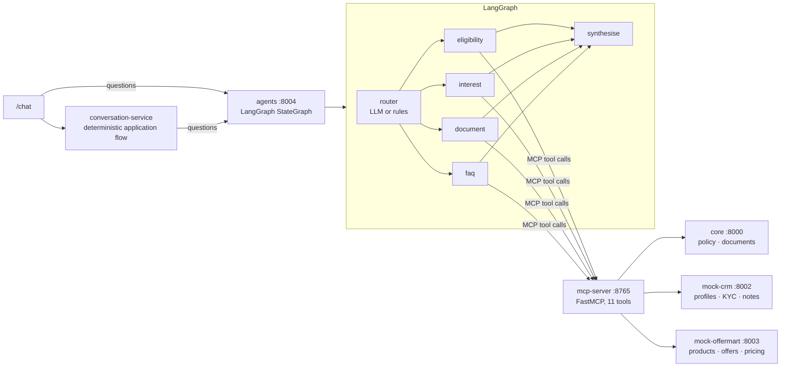
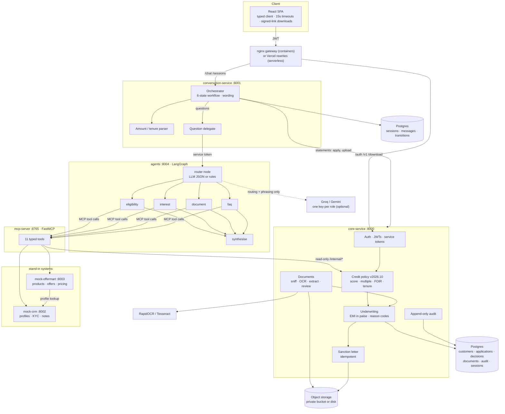
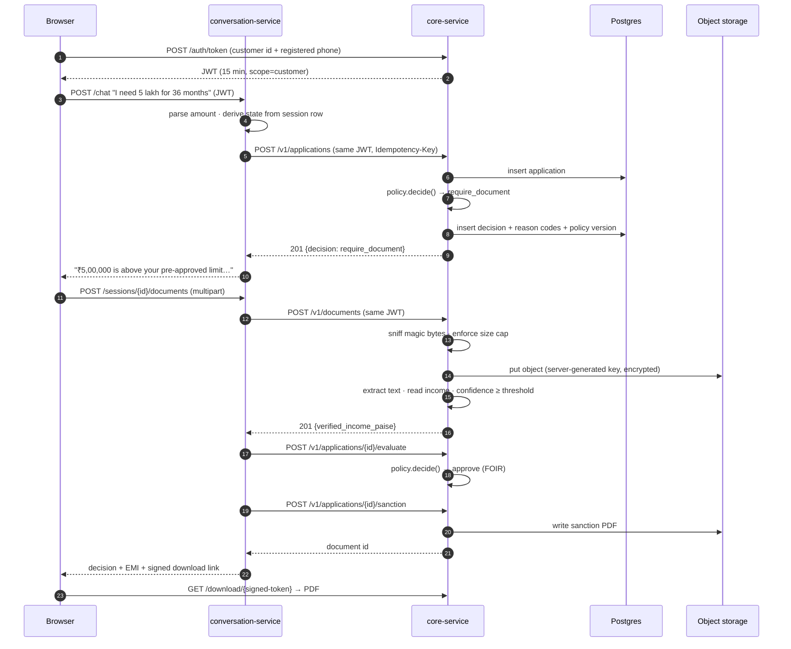

<p align="center">
  
</p>

# TataBot — policy-first loan origination

A conversational personal-loan origination stack built as **two services behind one origin**.
The language model writes the words. A versioned credit policy makes the decision. Every
figure, document and state change is traceable.

**[Live demo](.)** · [Architecture](#architecture) · [Deploy on Vercel](#deploy-on-vercel) · [Run locally](#run-locally)

> Independent engineering demonstration. Not affiliated with, endorsed by, or operated by any
> bank or NBFC. No real customer data is processed, no bureau is queried and no credit is
> offered. Sanction letters are stamped as simulated.

---

## Screenshots

Captured from a running stack — real services, a real payslip upload, real responses.
Full set with captions: [`docs/SCREENSHOTS.md`](docs/SCREENSHOTS.md) ·
[whole landing page in one image](docs/screenshots/00-landing-full.png).

| Landing | Above-limit request | Approved after verification |
|---|---|---|
|  |  |  |

| Sanction letter | Decline path | Status tracker |
|---|---|---|
|  |  |  |

| Create your own account | Decision on your own numbers | Contact us |
|---|---|---|
|  |  |  |

| Routing trace | History panel | Reopened conversation |
|---|---|---|
|  |  |  |

| Eligibility agent | Interest agent | Two agents on one question |
|---|---|---|
|  |  |  |

---

## Why this exists

Most "AI loan assistant" demos put a model in front of a database and hope. That fails the two
tests a lender actually applies: *can you explain the decision?* and *what happens when the
model is wrong?*

This build answers both. The model's job is narrowed to language. Eligibility, pricing, limits
and document requirements are deterministic code with a version attached. The workflow position
lives on the server, so a client cannot talk its way past a verification step. Documents are
verified rather than declared, and nothing identifying ever reaches the model.

| | |
|---|---|
| **Decision maker** | `services/core/core_service/policy.py` — pure, deterministic, versioned |
| **What the LLM does** | Wording only, behind a guard that strips identifiers and discards any output containing a figure |
| **Where state lives** | Postgres, keyed by session — not in the browser, not in a process dict |
| **What unlocks a higher limit** | Verified income from a processed document, never a declared salary |

---

## What is real, and what is simulated

A fair question about any demo, so here is the answer without hedging.

| Component | Status |
|---|---|
| Credit policy, EMI, FOIR, limit rules | **Real code.** Deterministic, versioned, unit-tested. No model involved. |
| Application, decision, document, audit records | **Real rows** in Postgres/SQLite, written per request and readable afterwards. |
| JWT auth, ownership checks, signed download links | **Real.** Enforced by the API, covered by tests. |
| Salary-slip extraction | **Real parsing** of the PDF text layer with an honest confidence score. No OCR, so scans go to review instead of being guessed. |
| Assistant wording | **Templates**, deterministic. The LLM is optional and disabled by default; when enabled it may only reword, never quote a figure. |
| Customer records | **Stored, not hardcoded** — but the ten demo profiles are seeded on first boot. Anyone can register and use their own details; see below. |
| Credit score | **Self-declared** at signup in this build, and recorded as such. A production deployment pulls it from a bureau. |
| Pre-approved limit | **Offered** for seeded demo customers; **derived** (6 × declared income, capped by policy) for self-registered ones, and labelled indicative. |
| KYC | **Demo provider**: matches the phone against the record instead of sending an OTP. |
| Contact-us channels | **Placeholders.** Messages are stored with a reference, but nobody is paged. |
| Bureau pull, disbursal, e-sign | **Not implemented.** |

### Register and use your own numbers

The app is not limited to the seeded customers. On the sign-in screen, **Create account** writes a
new customer row with your own name, phone, income and declared score, derives an indicative
limit from that income, signs you in, and every decision afterwards is computed from your data
and stored. The status page lists your own applications, read back from the database.

Two things are labelled rather than faked: your credit score is marked *self-declared*, and the
limit is marked *indicative* — it is derived, not an offer.

---

## The agent layer

Five services now, and the agent layer is real LangGraph — not a state machine wearing the
label.



**What is genuinely there now:**

| Claim | Status |
|---|---|
| LangGraph orchestrator | `services/agents/agents/graph.py` — a real `StateGraph` with a conditional fan-out from `router` to four worker nodes, converging on `synthesise`. |
| LLM that routes dynamically | The router asks the model for JSON (`{"agents": [...]}`) and validates it against the allowed worker set; an invented worker is discarded. With no key it falls back to keyword rules, so the graph runs either way. Groq or Gemini via `LLM_PROVIDER`. |
| One key per role | `GROQ_API_KEY_ROUTER`, `..._ELIGIBILITY`, `..._INTEREST`, `..._DOCUMENT`, `..._FAQ`. A role without its own key falls back to `GROQ_API_KEY`; a role with no key at all runs on the rule router. `GET /agent/models` reports which roles have a key — never the key. `scripts/check_groq_keys.py` verifies each one with a single call. |
| 4 specialised worker agents | `eligibility`, `interest`, `document`, `faq` — each with its own tool subset, its own prompt and its own fallback template. |
| FastMCP server | `services/mcp-server` — a real `FastMCP` instance exposing 11 typed tools, tested through the MCP client protocol (not by calling the functions directly). |
| MockCRM + OfferMart | Two real services with HTTP contracts. OfferMart calls the CRM for the profile rather than duplicating it. |
| OCR document parsing | `services/core/core_service/ocr.py` — RapidOCR (ONNX) or Tesseract, with the text-layer path preferred for PDFs and rasterised pages for scans. Below the confidence floor the document goes to review instead of being guessed. |

**What the agents may not do.** They hold read-only tools. `check_eligibility` runs the policy
and returns an outcome; it cannot create an application, issue a sanction letter or move money.
A test asserts that a burst of agent questions leaves the application count unchanged.

**Two guards worth knowing.** The router's model output is validated, and any prose a worker
gets back from a model is only used if every number in it appears in the tool output it was
given — otherwise the deterministic template answers. So an LLM cannot invent an EMI.

## Routing and coordination

"Is the orchestrator actually routing things?" is answerable without reading code: every
transition is recorded with the component that caused it, and exposed at
`GET /sessions/{id}/trace`. The status page renders it ("How this application moved").

```
new               ──greeting──────────────▶ awaiting_amount      conversation-service
awaiting_amount   ──outcome_document_required▶ awaiting_document  core-service · policy
awaiting_document ──document_received──────▶ assessing            core-service · extraction
assessing         ──outcome_approved───────▶ sanctioned           core-service · policy + sanction
```

Two different things route, and it is worth keeping them apart:

* **The application flow** (`conversation-service`) is a deterministic state machine. Statements
  like "I need 5 lakh for 36 months" create an application and move it through verification,
  assessment and sanction. No model is involved in the decision.
* **Questions** ("can I get 5 lakh?", "what's the EMI?", "which documents?", "is my data safe?")
  are delegated to the LangGraph orchestrator, which picks the workers and answers from tool
  results. A question never moves the application workflow — there is a test for exactly that.

The decision itself is still made by `policy.py` in the core service. The agents explain it; they
do not make it.

The routing is covered by an exhaustive matrix test: **6 states × 9 events = 54 combinations**,
asserting each is allowed exactly where the transition table says and refused everywhere else.

---

## Architecture

Six services, one origin, and a single rule that keeps the whole thing honest: **the layer that
talks cannot decide, and the layer that decides cannot talk.**



Three properties worth noticing in that diagram:

* **The agent layer holds only read-only tools.** `check_eligibility` runs the policy and returns
  an outcome; there is no tool that creates an application, issues a letter or moves money. A test
  asserts that a burst of agent questions leaves the application count unchanged.
* **The conversation service never holds customer data.** It forwards the customer's own JWT to the
  core, so the core always checks the caller's identity — the conversational layer cannot escalate.
* **The CRM and the offer engine are separate systems.** OfferMart asks MockCRM for the profile
  rather than keeping its own copy, and falls back to the core's summary for a customer the CRM has
  never seen (someone who registered minutes ago).

### A question, end to end

```mermaid
sequenceDiagram
    autonumber
    participant U as Customer
    participant C as conversation-service
    participant A as agents (LangGraph)
    participant M as mcp-server
    participant K as core-service
    participant O as offermart

    U->>C: "can I get 5 lakh and what would the EMI be?"
    C->>C: question-shaped → delegate (workflow state untouched)
    C->>A: POST /agent/query (service token, customer id)
    A->>A: router → ["eligibility", "interest"] (validated against the allowed set)
    par eligibility
        A->>M: check_eligibility(customer, 5,00,000, 36)
        M->>K: POST /internal/eligibility/preview
        K-->>M: outcome, reason codes, policy version
    and interest
        A->>M: get_preapproved_offer + quote_emi
        M->>O: /v1/offers/{id}, /v1/price
        O-->>M: product, rate, EMI in paise
    end
    A->>A: synthesise; every figure must appear in a tool result
    A-->>C: answer + route + citations
    C-->>U: reply with the agent chips and sources
```

### One request, end to end



---

## Features

### Conversation
- Natural-language intake for amount and tenure — understands `5 lakh`, `2.5 lakh`, `75k`,
  `₹3,00,000`, `1.5 crore`.
- Amount parsing **refuses to guess**: a bare number without a unit or loan-intent word is not
  treated as an amount, and a pincode is never mistaken for a loan.
- Server-side state machine: `new → awaiting_amount → awaiting_document → sanctioned / rejected`,
  with an allowed-transition table. Skipping a step is not expressible.
- Explicit `awaiting_document` state, so a document request is a resumable step rather than a
  dead end.
- Works fully with the LLM disabled — replies fall back to deterministic templates.

### Onboarding and support
- **Self-service signup** — a new customer registers with their own details; the record is
  written to the database and used for a real decision immediately.
- **Provenance on every figure** — `score_source` and `limit_source` are stored, so a decision
  can state whether it trusted a bureau-style score or the applicant's word, and whether the
  limit was offered or derived.
- **Contact us inside the chat** — a support panel with channels, a stored message form and a
  reference (`SUP-XXXXXX`) the customer can quote; their earlier tickets are listed from the
  database. Asking the assistant for a human opens the same panel without disturbing the flow.

### Credit policy
| Rule | Value | Behaviour |
|---|---|---|
| Minimum credit score | 700 | decline with `credit_score_below_min` |
| Customer age | 21–60 | decline with `age_out_of_range` |
| Ticket size | ₹10,000 – ₹50,00,000 | refused before a decision |
| Tenure | 6 – 60 months | refused before a decision |
| Up to pre-approved limit | — | approve; EMI quoted |
| Above limit, up to 2× | verified income required | approve if EMI ≤ 50% of verified income, else decline |
| Above 2× limit | — | decline with `amount_above_max_multiple_of_pre_approved` |

Every decision stores its reason codes and the policy version that produced it, so a decline can
be explained months later without reconstruction.

### Documents
- Multipart upload, size-capped while streaming (never buffered beyond the limit).
- Content type decided by **magic bytes**, not the filename or the declared header.
- Server-generated object keys (`{customer}/{uuid}.pdf`) — a hostile filename cannot traverse.
- Text-layer PDF extraction with the confidence it actually achieved. Below threshold, or for
  images with no OCR, the document is flagged for review and contributes **no** income.
- One sanction letter per application, enforced by a unique constraint — a retry cannot issue two.

### Security
- Customer-scoped JWTs (audience, issuer, expiry, scope all validated) and separate service
  tokens for service-to-service calls.
- Ownership resolved from the token on every read; another customer's resource returns **404**,
  not 403, so the API never confirms what exists.
- Downloads only through HMAC-signed, single-purpose links that expire in 60 seconds.
- Audit rows are append-only with redacted metadata, and no HTTP route can read them.
- Rate limiting per caller; `X-Forwarded-For` trusted only when explicitly enabled.
- Errors return a stable code and a request id; internals are logged, never serialised.
- The app refuses to boot in production with demo login enabled.

### Model keys
- **One Groq key per role**, so a burst of eligibility questions cannot exhaust the quota the
  router needs. Fill `services/agents/.env` (gitignored) — never the repository.
- **`scripts/check_groq_keys.py`** probes every configured key with a one-token call, prints the
  model and latency per role, warns if two roles share a key, and names the models your account
  can actually use when one 404s.
- **`GET /agent/models`** returns the provider, the model, and `own`/`shared`/`missing` per role.

### Routing and observability
- **Server-side state machine** with an allowed-transition table; every change is a row with the
  event that caused it.
- **`GET /sessions/{id}/trace`** returns the route taken and the component behind each step —
  shown in the UI as "How this application moved".
- **Exhaustive routing test** over every state/event pair, so a future edit to the table cannot
  quietly open a shortcut to a decision.

### Operations
- JSON logs with a request id on every line.
- `/health` is liveness (no dependency calls); `/ready` checks the database, storage and the core
  service and returns 503 when degraded.
- Prometheus metrics at `/metrics`.
- Timeouts, bounded retries and a circuit breaker around the core service and the LLM.

---

## Metrics

Two kinds, kept apart: what the build contains (countable) and what it does at runtime (measured).

### The build

| | |
|---|---|
| Services | 6 (`core`, `conversation`, `agents`, `mcp-server`, `mock-crm`, `mock-offermart`) + SPA |
| Python | ~8,150 lines across the services, ~3,300 lines of tests |
| TypeScript | ~3,400 lines |
| HTTP endpoints | 47 |
| MCP tools | 11, typed, exercised through the MCP protocol |
| Agent graph | 1 router → 4 workers → 1 synthesiser |
| Workflow | 6 states, 10 events, 26 legal transitions, 54-combination routing matrix |
| Credit policy | 1 versioned module; 9 reason codes; EMI and FOIR in integer paise |
| Tests | **303** — 82 core · 115 conversation · 8 CRM · 11 OfferMart · 23 MCP · 64 agents |
| Coverage | core 89% · conversation 86% · agents 88% · mcp-server 85% · CRM 91% · OfferMart 78% |
| Lint and types | ruff clean; mypy clean on 80 files; `tsc` and eslint clean |
| Screenshots | 34, captured from a running stack |

### At runtime — measured, not estimated

`scripts/benchmark.py` measures these on your machine. Numbers below are from one sandbox
(2 vCPU, SQLite, everything in-process, ONNX threads capped at 1), so read them as orders of
magnitude rather than a service level objective.

| Path | Median | p95 |
|---|---|---|
| Credit decision (pure policy function) | **10.9 µs** | 15.6 µs |
| EMI, integer paise | **6.0 µs** | 6.8 µs |
| Chat turn: greeting → apply → decide (incl. DB writes) | **120 ms** | 197 ms |
| Agent turn, rules router | **73 ms** | 133 ms |
| Agent turn, real Groq call (`gpt-oss-20b`) | **1.85 s** | 2.72 s |
| OCR, payslip image (warm) | **2.1 s** | 2.2 s |
| OCR cold start (engine load) | 4.1–5.3 s | — |

What that means in practice: the decision itself is effectively free, and the money is spent on
the two things that are genuinely slow — a model call and OCR. That is why the model is optional
and OCR runs once per document rather than per turn.

### What is *not* measured

No production traffic, no labelled dataset, no load test, no error budget. There is no accuracy
figure because nothing has been scored against ground truth, and no conversion or cost saving
figure because no real customer has used it. Those are the numbers a pilot would produce, and they
are deliberately absent here.

## Impact

### What changes in the system

| Function | Without this | With it |
|---|---|---|
| "Am I eligible?" | A human reads a policy sheet, or the customer guesses | Answered from the same policy module that decides, in one turn, with the policy version attached |
| EMI quotes | Spreadsheet, or a rate the agent remembers | Priced by the offer engine at the customer's own product rate; the figure the sanction letter will carry |
| Document check | Someone opens the PDF and reads the salary line | OCR reads it, confidence-scored; below the floor it goes to a human instead of being guessed |
| Decision | Discretion, unrecorded | Versioned rule, reason codes, stored with the inputs |
| Sanction letter | Typed and signed | Generated idempotently, downloadable through a signed 60-second link |
| Audit | Reconstructed after the fact | Append-only rows with identifiers redacted |
| Policy change | Re-training, or drift | One file, a version bump, and old decisions still explain themselves |

### What it does for different organisations

**NBFC / mid-size lender.** The expensive part of unsecured lending is not the decision, it is the
hour of a loan officer's time spent on the questions before the decision. Policy questions,
eligibility checks and document requirements are a fixed script, and this puts them on rails with
the reasoning attached. The audit trail and reason codes are also what a regulator or an internal
audit asks for first.

**Digital lender with an existing app.** The service boundary is the useful part: `core-service`
can sit behind whatever front end already exists, and the agent layer can be switched off entirely
(`LLM_PROVIDER=rules`, or drop the service) without touching the decision path.

**Bank or co-lending arrangement.** Every decision records its policy version, its inputs and its
reason codes, and the audit table is append-only. That is the evidence a co-lending partner or an
RBI inspection would ask for, and it exists by construction rather than by report.

**Risk and compliance.** The credit decision is a deterministic function with unit tests — not a
model. The language model cannot approve, decline, or invent a figure; there are tests for each of
those. Policy changes are reviewable diffs, not prompt edits.

**Engineering.** Six services with 303 tests and no cross-service imports; the seams are HTTP
contracts, so any one of them can be replaced. The conversation layer can be deleted and the core
still lends.

### What it does not do

It does not verify identity (no OTP, no bureau pull — the score is self-declared), it does not
disburse, and it has not been through a security review or a penetration test. The CRM and offer
engine are stand-ins with real contracts, not vendor integrations. Nothing here should be pointed
at a real customer without the list in
[`docs/PRODUCTION-READINESS.md`](docs/PRODUCTION-READINESS.md) being closed first.

### Building the business case

Three numbers decide whether this is worth anything, and only a pilot can produce them:

1. **Share of inbound questions answerable from the policy** — measure by sampling a week of
   support transcripts and tagging them.
2. **Handling time per application before and after** — the officer's clock, not the system's.
3. **Document rejection rate** — how often an upload is unusable, which is where OCR quality shows
   up economically.

Multiply the first two by volume and you have the saving. Anything stated before that is a guess,
which is why this README does not state it.

## Repository layout

```
.
├── apps/
│   └── web/                        React + Vite SPA, Tailwind, single origin
│       ├── src/
│       │   ├── components/landing/  landing page sections
│       │   ├── lib/                 typed API client, formatters, contracts
│       │   └── pages/               Home · Login · Chat · StatusTracker
│       ├── nginx.conf               gateway config for the container image
│       └── Dockerfile               build → nginx runtime
├── services/
│   ├── core/                       the only place credit policy and customer data live
│   │   ├── core_service/
│   │   │   ├── policy.py           deterministic underwriting (single source of truth)
│   │   │   ├── money.py            paise arithmetic + EMI
│   │   │   ├── security.py         JWTs, signed download tokens
│   │   │   ├── storage.py          local + S3 object stores behind one interface
│   │   │   ├── extractors.py       PDF text + OCR extraction with honest confidence
│   │   │   ├── ocr.py              RapidOCR / Tesseract behind one interface
│   │   │   ├── services/           kyc · documents · underwriting · sanction · audit
│   │   │   │                       onboarding (signup) · support (contact us)
│   │   │   ├── migrations.py       additive schema patches until Alembic lands
│   │   │   ├── routers/            auth · customers · applications · documents · health
│   │   │   └── worker.py           extraction queue
│   │   └── tests/                  53 tests
│   ├── agents/                     LangGraph orchestrator + 4 workers
│   │   ├── agents/graph.py         StateGraph: router → workers → synthesise
│   │   ├── agents/router.py        LLM JSON routing, validated, rules fallback
│   │   ├── agents/llm.py           one key per role; the grounding guard
│   ├── mcp-server/                 FastMCP tool server (11 tools)
│   ├── mock-crm/                   CRM stand-in: profiles, KYC, interactions
│   ├── mock-offermart/             offer + pricing engine stand-in
│   └── conversation/               state machine + wording, no customer data
│       ├── conversation_service/
│       │   ├── workflow.py         states, events, allowed transitions
│       │   ├── orchestrator.py     the engine
│       │   ├── amounts.py          amount/tenure parsing
│       │   ├── llm.py              guarded model access
│       │   └── clients.py          async core client with retries + circuit breaker
│       └── tests/                  35 tests (drive the real core app in-process)
├── api/                            Vercel serverless entrypoints (ASGI)
├── docs/
│   ├── logo.svg                    the mark, also used as the favicon
│   ├── SCREENSHOTS.md              every capture, with captions
│   ├── PRODUCTION-READINESS.md     what was fixed, and what is still open
│   ├── SCREENSHOTS.md              the captured walkthrough, with captions
│   └── screenshots/                17 PNGs, committed so the README renders on GitHub
├── scripts/
│   ├── smoke_test.py               end-to-end checks against a running stack
│   ├── check_groq_keys.py          verify each role's model key with one call
│   └── benchmark.py                the latency table above
├── vercel.json                     rewrites, headers, function limits
├── docker-compose.yml              Postgres + six services + gateway
├── Makefile                        install · test · lint · typecheck · run
├── requirements.txt                composed runtime deps for Vercel
├── CONTRIBUTING.md                 ground rules: where policy lives, what a PR must pass
└── LICENSE                         MIT
```

---

## Run locally

### Docker (whole stack, Postgres included)

```bash
cp .env.example .env
python -c "import secrets; print(secrets.token_urlsafe(48))"   # → JWT_SECRET
python -c "import secrets; print(secrets.token_urlsafe(32))"   # → SERVICE_CLIENT_SECRET
# set ALLOW_DEMO_AUTH=true while trying it out
docker compose up --build
# → http://localhost:8080
```

### Three terminals

```bash
# 1 — core service
cd services/core
cp .env.example .env            # set JWT_SECRET + SERVICE_CLIENT_SECRET
pip install -r requirements-dev.txt
uvicorn core_service.main:app --reload --port 8000

# 2 — conversation service
cd services/conversation
cp .env.example .env            # same JWT_SECRET and client secret
pip install -r requirements-dev.txt
uvicorn conversation_service.main:app --reload --port 8001

# 3 — web
cd apps/web
npm ci
npm run dev                     # http://localhost:8080, proxies both services
```

Optional: `cd services/core && python -m core_service.worker` for the extraction queue
(normal uploads are extracted inline, so this is only needed for retries and scans).

### Reproducing the numbers

```bash
# tests and coverage per service
cd services/core && python -m pytest --cov=core_service --cov-report=term
cd services/conversation && PYTHONPATH=.:../core python -m pytest --cov=conversation_service
cd services/agents && python -m pytest --cov=agents

# latency
python scripts/benchmark.py
```

### Benchmarks and key checks

```bash
python scripts/benchmark.py                 # the latency table above, on your machine
python scripts/benchmark.py --llm           # also time a real model turn
python scripts/check_groq_keys.py           # one call per configured key, model and latency
```

### Demo customers

| ID | Name | Pre-approved | What it demonstrates |
|---|---|---|---|
| CUST001 | Asha Verma | ₹3,00,000 | straight approval |
| CUST002 | Rahul Sharma | ₹2,00,000 | straight approval |
| CUST004 | Vikram Singh | ₹1,50,000 | below the score floor — the decline path |
| CUST010 | Sourav Ghosh | ₹5,00,000 | higher ticket |

Sign in with the ID and its registered number, ask for **more than the pre-approved limit**
(e.g. `I need 5 lakh for 36 months` as CUST001), then upload a payslip PDF containing a
`Net Pay:` line to watch the decision change.

---

## Deploy on Vercel

The SPA and both APIs deploy as one Vercel project: the frontend is static, and each service is
a Python serverless function under `/api`.

**Serverless changes two things, and the code already accounts for both:**

1. **No persistent disk** → set `STORAGE_BACKEND=s3` and point it at any S3-compatible bucket
   (AWS S3, Cloudflare R2, Supabase Storage). `LocalObjectStore` is for containers and local dev.
2. **No long-lived worker** → uploads are extracted inline on the request (`process_now`); the
   `worker.py` queue is only used where a process can idle.

### Prerequisites

- A Postgres database — [Neon](https://neon.tech), Supabase or Vercel Postgres. SQLite will not
  work: the filesystem is read-only.
- A private S3-compatible bucket for documents and sanction letters.

### Steps

```bash
npm i -g vercel
vercel link
```

Set these in **Project → Settings → Environment Variables** (Production and Preview):

| Variable | Value | Notes |
|---|---|---|
| `ENV` | `demo` | use `production` only with real auth — the app refuses to boot in production with demo login on |
| `JWT_SECRET` | 48-byte random string | **identical** in both functions |
| `SERVICE_CLIENT_ID` | `conversation-service` | |
| `SERVICE_CLIENT_SECRET` | 32-byte random string | **identical** in both functions |
| `ALLOW_DEMO_AUTH` | `true` for the demo | must be `false` in production |
| `DATABASE_URL` | `postgresql+psycopg://…` | Neon/Supabase connection string |
| `STORAGE_BACKEND` | `s3` | required on Vercel |
| `S3_BUCKET` | your bucket name | |
| `S3_REGION` | `ap-south-1` | match your bucket |
| `S3_ENDPOINT_URL` | R2/Supabase endpoint | omit for AWS S3 |
| `AWS_ACCESS_KEY_ID` / `AWS_SECRET_ACCESS_KEY` | bucket credentials | or use an OIDC role |
| `ALLOWED_ORIGINS` | `https://<your-project>.vercel.app` | |
| `CORE_BASE_URL` | `https://<your-project>.vercel.app/api/core` | how the conversation function reaches the core function |
| `LLM_ENABLED` | `false` | templates work without a key; set `GOOGLE_API_KEY` to enable |

Then:

```bash
vercel --prod
```

`vercel.json` already routes `/auth`, `/v1`, `/download` to the core function and `/chat`,
`/sessions` to the conversation function, and applies security headers. Because everything is on
one origin, there is no CORS surface at all.

### Vercel limits worth knowing

- Function memory is 1 GB and `maxDuration` 30s in `vercel.json`; a cold start plus a first
  request can take a few seconds.
- `psycopg` and `reportlab` are compiled wheels — the Python runtime supports them, but keep an
  eye on the 250 MB unzipped bundle limit if you add heavy dependencies.
- Schema creation runs on the first request (`_ensure_schema`), which is fine for a demo; use
  Alembic migrations before real traffic.

---

## API surface

| Method | Path | Auth | Purpose |
|---|---|---|---|
| `POST` | `/auth/token` | none | customer id + registered phone → JWT |
| `POST` | `/auth/service-token` | client credentials | service token for service-to-service calls |
| `POST` | `/v1/customers` | none | **self-service signup** — writes a new customer row |
| `GET` | `/v1/customers/me` | customer | own profile (band only, never the raw score) |
| `POST` | `/v1/applications` | customer | create + assess (supports `Idempotency-Key`) |
| `GET` | `/v1/applications` | customer | own applications |
| `GET` | `/v1/applications/{id}/status` | customer | stage, decision, reason codes |
| `POST` | `/v1/applications/{id}/evaluate` | customer | re-assess once a document has arrived |
| `POST` | `/v1/applications/{id}/sanction` | customer | issue the letter (idempotent) |
| `POST` | `/v1/documents` | customer | multipart upload |
| `GET` | `/v1/documents/{id}/signed-url` | customer | 60-second download link |
| `GET` | `/download/{token}` | signature | redeem the link |
| `POST` | `/chat` | customer | one conversational turn |
| `GET` | `/sessions/{id}` | customer | session + application state |
| `GET` | `/sessions/{id}/messages` | customer | transcript |
| `POST` | `/sessions/{id}/documents` | customer | upload inside a conversation |
| `POST` | `/v1/support/messages` | optional | store a contact-us message, returns a reference |
| `GET` | `/v1/support/messages` | customer | the caller's own tickets |
| `POST` | `/agent/query` | service token | run the agent graph for a question |
| `GET` | `/agent/graph` | none | the compiled graph: nodes, edges, worker scopes |
| `GET` | `/health` `/ready` `/metrics` | none | liveness, readiness, metrics |

---

## Quality gates

```bash
make test        # 292 backend tests across six suites + web unit tests
make lint        # ruff + eslint
make typecheck   # mypy + tsc
make smoke       # end-to-end against a running stack
```

Current state: **303 backend tests pass**, ruff and mypy clean across 50 source files, `tsc` and
`eslint` clean on the web app, and `scripts/smoke_test.py` passes 18/18 against a live stack.

The agent suite (64 tests) drives the whole chain in one process — conversation → graph → MCP
tools → CRM/OfferMart/core — so the end-to-end flow is a test, not a claim. The conversation
suite (111 tests) drives the **real** core application in-process, so it is an end-to-end
test with no mocks of the business logic and no servers to start.

CI (`.github/workflows/ci.yml`) runs lint, typecheck, tests and a production build for all three
packages, plus a check that no `.env` file is ever committed.

---

## Pushing to GitHub

The tree is already laid out the way GitHub expects: `apps/`, `services/`, `api/`, `docs/`,
`scripts/`, plus `.github/workflows/ci.yml` for CI.

```bash
git init
git add .
git commit -m "feat: policy-first loan origination stack"
git branch -M main
git remote add origin git@github.com:<you>/tatabot.git
git push -u origin main
```

Before the first push, confirm nothing sensitive is staged:

```bash
git status --short          # no .env, no *.db, no data/, no node_modules/, no dist/
```

`.gitignore` already excludes `.env*` (except `.env.example`), `node_modules/`, `dist/`,
`data/`, `*.db`, caches and `__pycache__/`. CI also fails the build if a `.env` file is ever
committed, and `pre-commit` (`.pre-commit-config.yaml`) blocks private keys and large binaries
before they reach a commit.

Two repository settings worth turning on: **branch protection** on `main` (require the CI
checks) and **Dependabot** for the three dependency manifests.

## Known limitations

Stated plainly, because a README that hides them is worse than one that is short.

1. **Demo login is not authentication of a person.** It proves knowledge of a customer id and
   phone number. Production needs OTP plus a KYC vendor, and `ENV=production` refuses to start
   with demo auth on.
2. **The credit score is self-declared.** No bureau is queried. The record says so
   (`score_source = self_declared`) and the UI marks it, but a real deployment must replace this
   with a bureau pull before any money moves.
3. **Extraction reads text layers only.** Scanned documents go to review; nothing is invented.
   The extractor interface is the seam for OCR or a vendor.
4. **No bureau, no disbursal, no notifications.** Support messages are stored but not routed to
   any queue or inbox. The sanction letter is a simulation and says so.
5. **Rate limiting is per process.** Correct for one instance; use Redis for a fleet.
6. **No migration history.** Schema comes from the models; add Alembic before the first change
   that must be applied to live data.
7. **No retention job.** Sessions and audit rows grow without bound; a purge policy is
   outstanding work for DPDP erasure.
8. **No OpenTelemetry traces yet.** Structured logs and Prometheus metrics only.
9. **Web tests cover formatting only.** The flow is covered end-to-end at the API level; a
   Playwright suite is the next step.

See [`docs/PRODUCTION-READINESS.md`](docs/PRODUCTION-READINESS.md) for the full fix-by-fix record
against the original review, including what is still open and why.

---

## License

MIT for the code in this repository. The demonstration is independent and is not a lending
product; no warranty is given and no regulatory approval is implied.
