<p align="center">
  
</p>

# TataBot — policy-first loan origination

TataBot is a personal-loan origination demo. The conversation service sends questions to a LangGraph router, which can run eligibility, interest, document, and FAQ workers together. Workers fetch facts through MCP tools. The lending core applies a versioned credit policy to application requests.

The default configuration uses rule-based routing and templated replies. Set `LLM_PROVIDER` to `groq` or `gemini` and configure credentials on the agent service to enable model-backed routing and responses.

For Gemini through Vertex AI on Cloud Run, set `LLM_PROVIDER=gemini`, `GOOGLE_GENAI_USE_VERTEXAI=true`, `GOOGLE_CLOUD_PROJECT`, `GOOGLE_CLOUD_LOCATION` and `GEMINI_MODEL` on the agent service. The SDK authenticates with the Cloud Run runtime service account. Enable the Vertex AI API and grant that account Vertex AI prediction access. Select a model available in the configured location.

[Run locally](#run-locally) · [Architecture](#architecture) · [Deploy on Vercel](#deploy-on-vercel)

**Verification.** The company demo exercises verified enrollment, a four-worker turn, quote comparison, ambiguous document extraction, human review, a policy decision and PDF issuance over HTTP. The lab uses signed synthetic identities and rule routing. Live identity and model providers require deployment credentials.

> Independent engineering demonstration. Not affiliated with, endorsed by, or operated by any
> bank or NBFC. No real customer data is processed, no bureau is queried and no credit is
> offered. Sanction letters are stamped as simulated.

---

## Company pilot

Run the complete HTTP demonstration from the repository root in a fresh Python 3.12 environment.

```sh
python -m pip install -r services/core/requirements-dev.txt -r services/conversation/requirements-dev.txt -r services/agents/requirements.txt
python scripts/demo_lab/run.py
```

The runner starts six services on loopback ports with temporary databases and private document storage. A local HTTPS test issuer signs separate applicant and reviewer identities. Core validates signature, issuer, audience, expiry and verified mobile claim. The runner prints the trace ID, participating workers, quote ID, application ID and final policy reason. It also runs the HTTP smoke suite and stops its processes. This reproducible demo uses rule routing. CI supplies Redis 7. Set `TEST_REDIS_URL` to a test Redis instance to include distributed request limiting locally.

### Present the applicant journey

1. Open `/login` and choose verified sign-in. Enrollment asks for the applicant’s details and explicit consent to assess income and uploaded evidence. Core records the verified mobile, identity issuer, subject binding and consent version. Credit score and income start as self-declared facts.
2. Ask “Am I eligible for 5 lakh over 36 months, what is the EMI, which documents do I need, and what is your privacy policy?” Open the session in **Status**. Each turn has a trace ID, routing source, worker start and finish times, tool outcomes, wording source and applicable policy version. The execution trace excludes raw questions, documents and salaries.
3. Open **Compare loans** from chat. Compare up to three amounts and tenures. Each application quote has a product, rate, EMI, total interest, expiry, decision preview and policy version. OfferMart supplies the indicative catalogue estimate. Core issues the application quote. Accepting it binds it to one application. A retry returns the same application. Expired or changed terms require a renewed confirmation.
4. Upload a salary slip on the decision page. Low-confidence evidence enters the underwriter queue. In a separate browser profile, sign in at `/review` with an authorized reviewer identity. Inspect the original, extracted fields and confidence. Confirm income, correct it, or request a replacement. Core records the reviewer, reason and evidence and re-evaluates the original application.
5. Refresh **Your decision** to see the outcome, reasons, assessed amount, income provenance and next action. An approval can issue a simulated sanction PDF.

### Configure the pilot

Register a public OpenID Connect client using authorization code with PKCE and `openid phone` scopes. Allow the frontend origin and exact callback `https://YOUR-HOST/identity`. The issuer must supply a verified `phone_number` in +91 format and boolean `phone_number_verified`. The browser validates state and nonce. Core validates RS256 ID tokens and binds returning customers to issuer and subject. Set `ENV=production` and `ALLOW_DEMO_AUTH=false` for a pilot using verified sign-in.

| Setting | Service | Purpose |
|---|---|---|
| `OIDC_ISSUER`, `OIDC_JWKS_URL`, `OIDC_AUDIENCE` | Core | Trusted HTTPS issuer, signing-key URL and public client ID |
| `OIDC_REVIEWER_SUBJECTS` | Core | Comma-separated reviewer subject allowlist |
| `VITE_OIDC_ISSUER`, `VITE_OIDC_CLIENT_ID` | Web build | Browser discovery and public client ID. Compose derives these from core configuration |
| `OIDC_CONNECT_ORIGIN` | nginx | Exact HTTPS discovery and token origins for the browser CSP. On Vercel add those origins to `connect-src` in `vercel.json` |
| `REDIS_URL` | Agents, conversation and core | Shared private Redis across replicas, provisioned by Compose |
| `MODEL_CALLS_PER_MINUTE`, `MODEL_MAX_CONCURRENT` | Agents | Per-provider request budget and simultaneous model-call limit |
| `AGENT_TURN_DEADLINE_SECONDS` | Agents | Time available for routing and worker execution |

Financial and verification answers are rendered from typed fields. Optional FAQ wording and router calls share the provider budget. Rules and templates take over when model capacity is unavailable. Legacy model-generated greetings are disabled with Redis and in production. Worker timeouts preserve completed sibling results.

Core reserves an idempotency key inside the underwriting transaction. Chat keeps an application-attempt identity across retries and creates a new one for restarts or superseding requests. Optimistic version checks reject stale session writes. New tables hold quotes, identity bindings, consent, review records, attempt IDs and turn traces.

To verify a hosted deployment with synthetic accounts, set `CORE_URL`, `CONVERSATION_URL`, `PILOT_APPLICANT_TOKEN`, `PILOT_REVIEWER_TOKEN` and `PILOT_PHONE`. Run `python scripts/company_demo.py` with a fresh verified applicant. This creates an application and a reviewed document in the target system. Bureau verification, bank feeds and fund disbursement remain external integrations.

## Screenshots

Captured from a running stack — real services, a real payslip upload, real responses.
Full set with captions: [`docs/SCREENSHOTS.md`](docs/SCREENSHOTS.md) ·
[whole landing page in one image](docs/screenshots/00-landing-full.png).

| Landing | Above-limit request | Approved after verification |
|---|---|---|
| 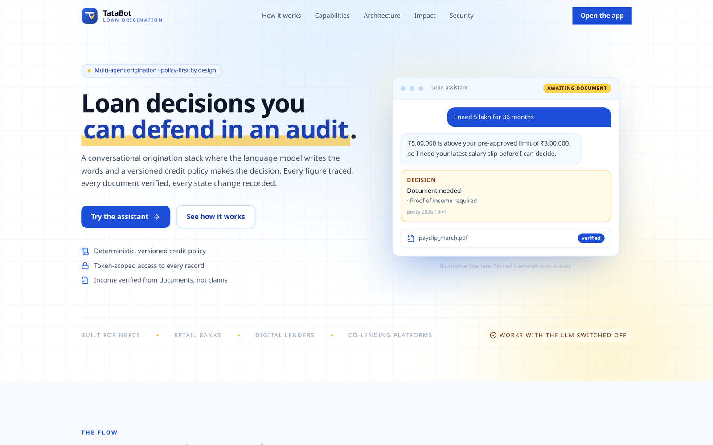 | 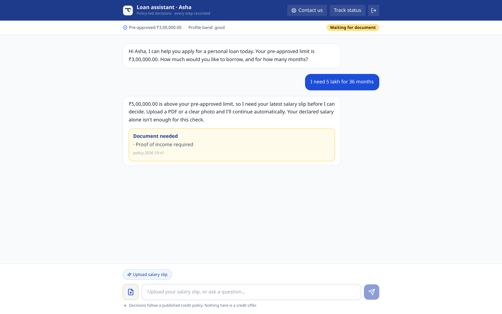 | 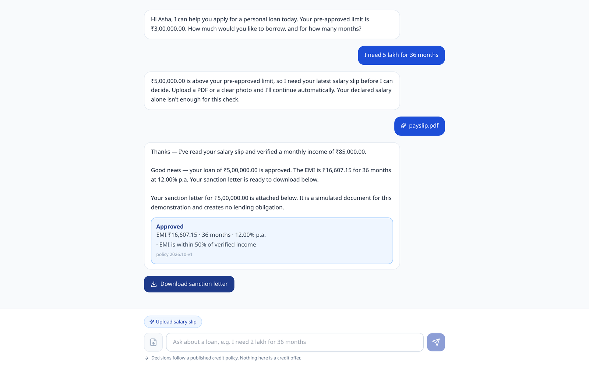 |

| Sanction letter | Decline path | Status tracker |
|---|---|---|
| 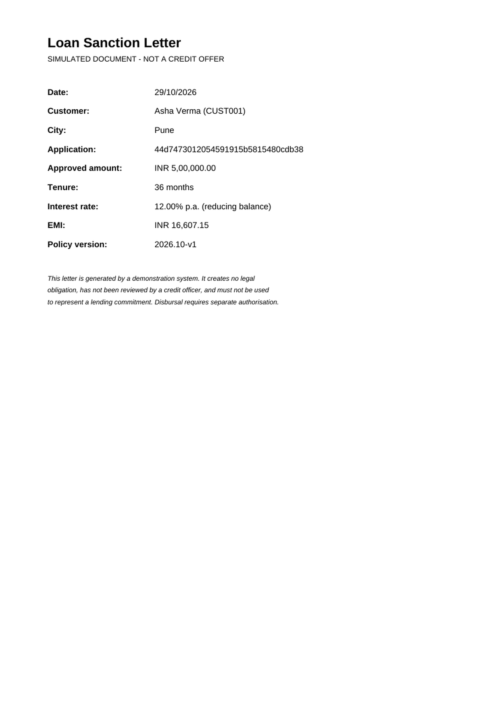 | 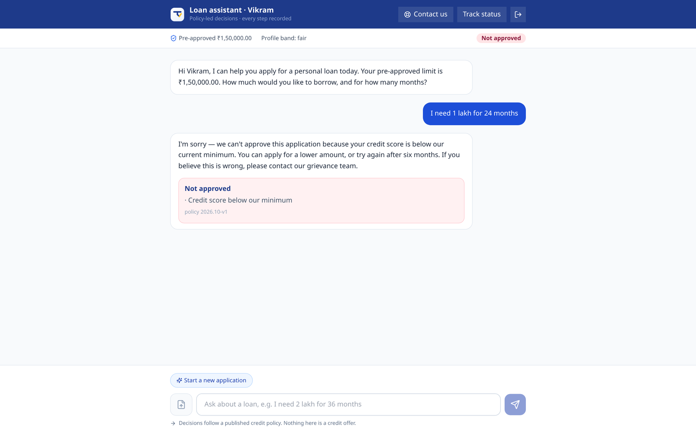 | 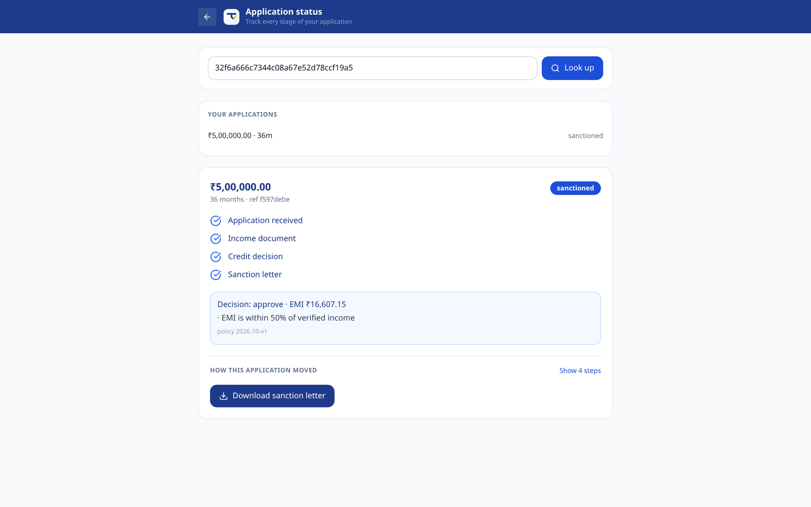 |

| Create your own account | Decision on your own numbers | Contact us |
|---|---|---|
| 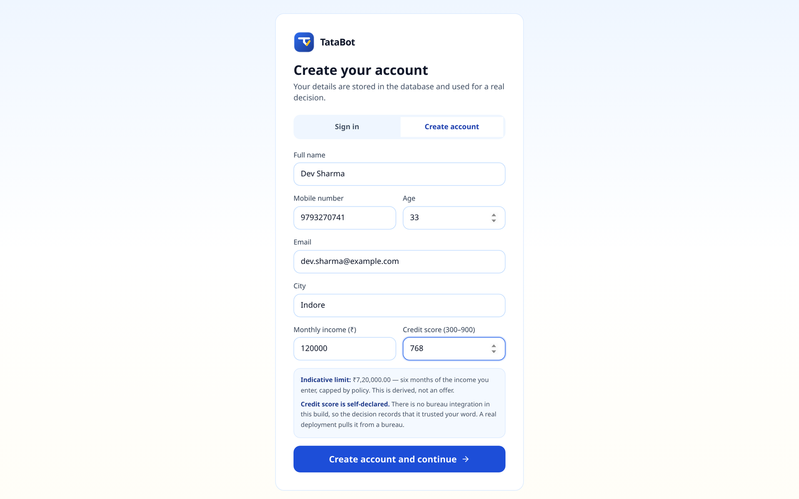 | 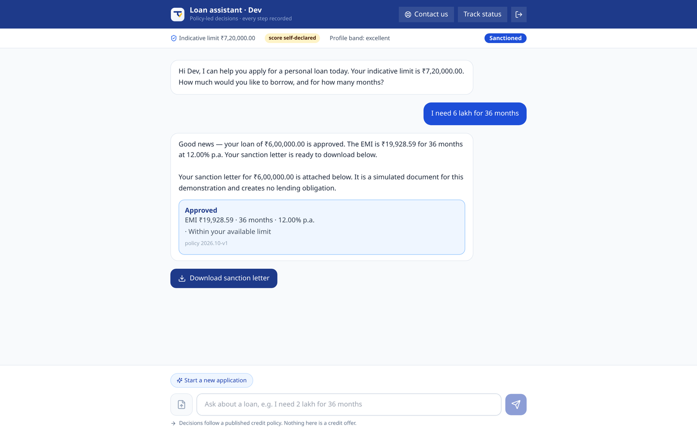 | 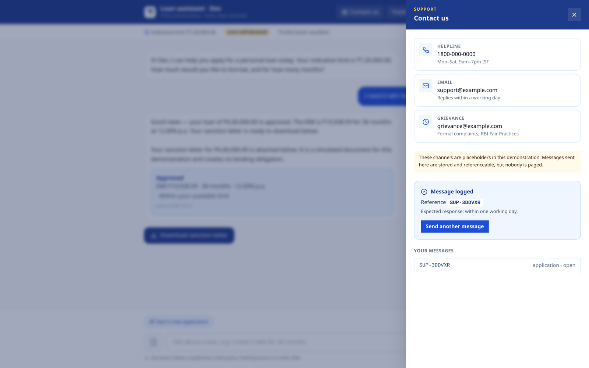 |

| Routing trace | History panel | Reopened conversation |
|---|---|---|
| 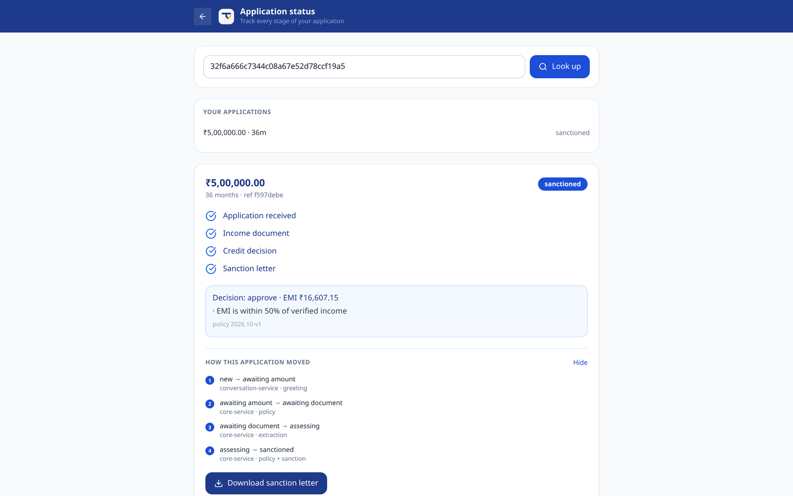 | 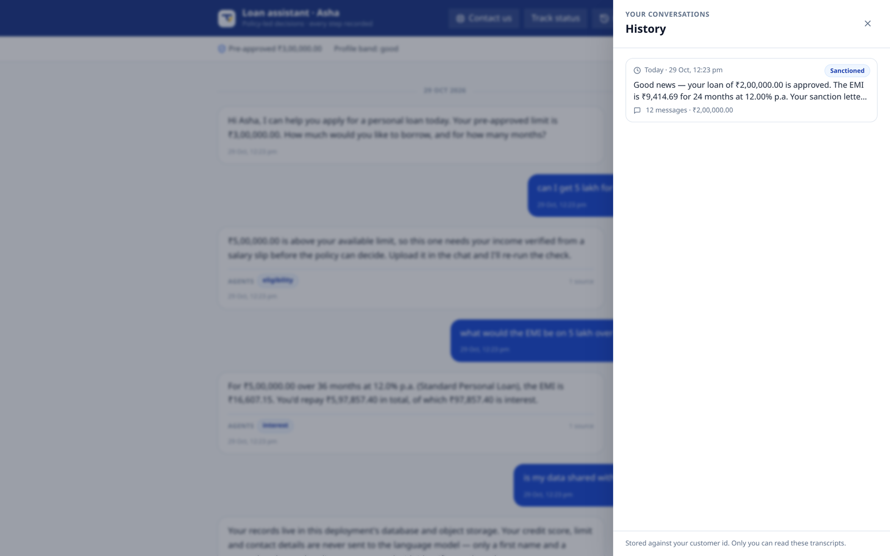 | 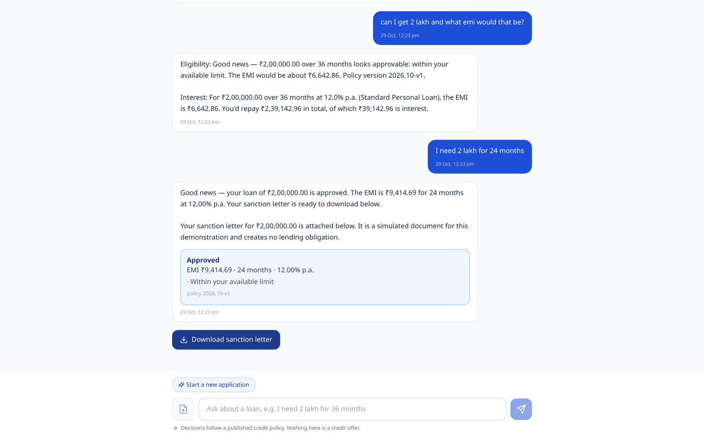 |

| Eligibility agent | Interest agent | Two agents on one question |
|---|---|---|
| 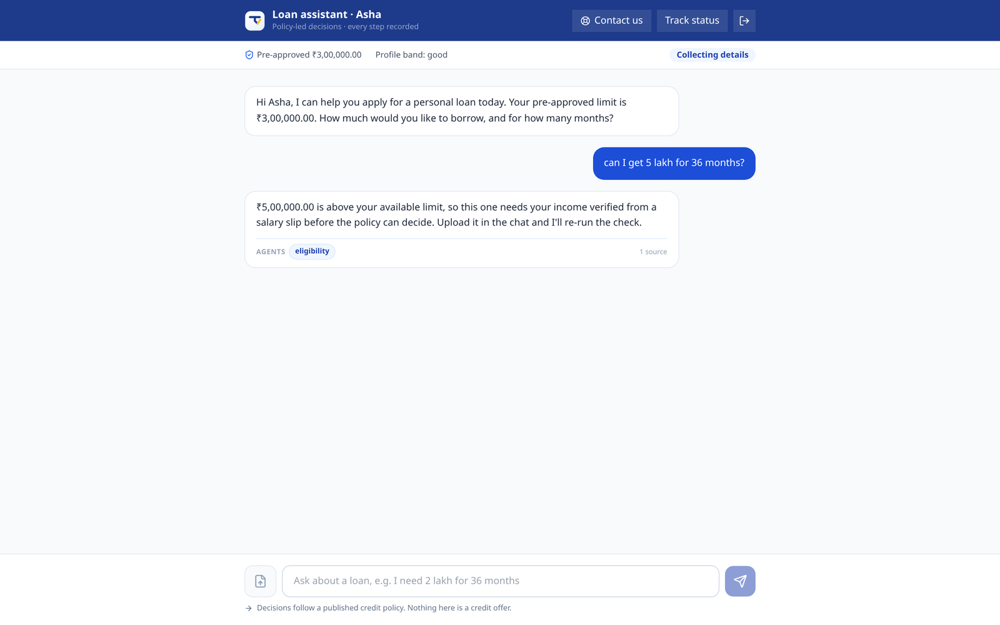 | 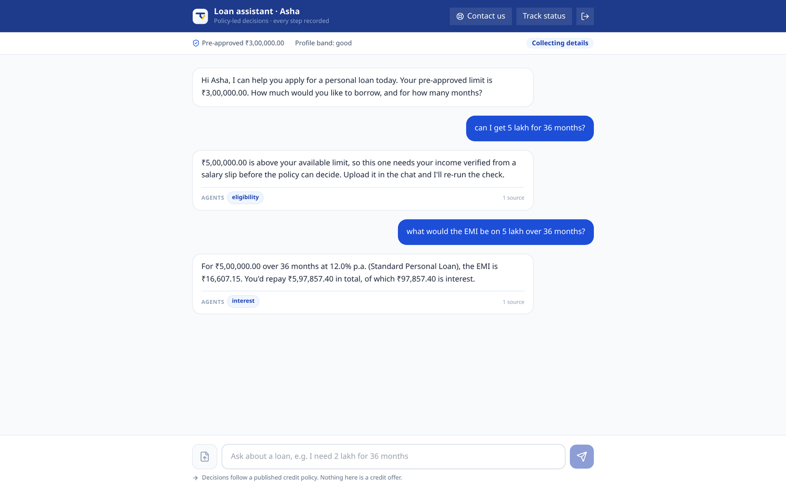 | 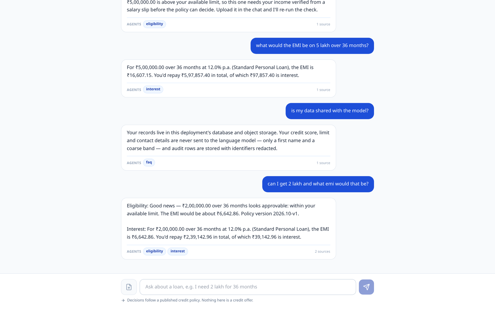 |

---

## Why this exists

Most "AI loan assistant" demos put a model in front of a database and hope. That fails the two
tests a lender actually applies: *can you explain the decision?* and *what happens when the
model is wrong?*

This build answers both. The model's job is narrowed to language. Eligibility, pricing, limits
and document requirements are deterministic code with a version attached. The workflow position
lives on the server, so a client cannot talk its way past a verification step. Documents are
verified rather than declared, and nothing identifying ever reaches the model.

| | |
|---|---|
| **Decision maker** | `services/core/core_service/policy.py` — pure, deterministic, versioned |
| **What the LLM does** | Wording only, behind a guard that strips identifiers and discards any output containing a figure |
| **Where state lives** | Postgres, keyed by session — not in the browser, not in a process dict |
| **What unlocks a higher limit** | Verified income from a processed document, never a declared salary |

---

## What is real, and what is simulated

A fair question about any demo, so here is the answer without hedging.

| Component | Status |
|---|---|
| Credit policy, EMI, FOIR, limit rules | **Real code.** Deterministic, versioned, unit-tested. No model involved. |
| Application, decision, document, audit records | **Real rows** in Postgres/SQLite, written per request and readable afterwards. |
| JWT auth, ownership checks, signed download links | **Real.** Enforced by the API, covered by tests. |
| Salary-slip extraction | **Real parsing** of the PDF text layer with an honest confidence score. Optional OCR handles scans; low-confidence readings enter underwriter review. |
| Assistant wording | **Templates**, deterministic. The LLM is optional and disabled by default; when enabled it may only reword, never quote a figure. |
| Customer records | **Stored, not hardcoded** — but the ten demo profiles are seeded on first boot. Anyone can register and use their own details; see below. |
| Credit score | **Self-declared** at signup in this build, and recorded as such. A production deployment pulls it from a bureau. |
| Pre-approved limit | **Offered** for seeded demo customers; **derived** (6 × declared income, capped by policy) for self-registered ones, and labelled indicative. |
| KYC | Verified OIDC mobile enrollment or demo phone matching. |
| Contact-us channels | **Placeholders.** Messages are stored with a reference, but nobody is paged. |
| Bureau pull, disbursal, e-sign | **Not implemented.** |

### Register and use your own numbers

The app is not limited to the seeded customers. On the sign-in screen, **Create account** writes a
new customer row with your own name, phone, income and declared score, derives an indicative
limit from that income, signs you in, and every decision afterwards is computed from your data
and stored. The status page lists your own applications, read back from the database.

Two things are labelled rather than faked: your credit score is marked *self-declared*, and the
limit is marked *indicative* — it is derived, not an offer.

---

## The agent layer

Five services now, and the agent layer is real LangGraph — not a state machine wearing the
label.

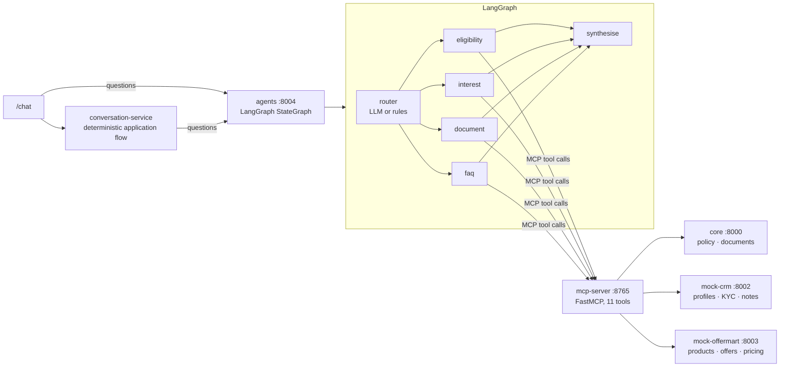

**What is genuinely there now:**

| Claim | Status |
|---|---|
| LangGraph orchestrator | `services/agents/agents/graph.py` — a real `StateGraph` with a conditional fan-out from `router` to four worker nodes, converging on `synthesise`. |
| LLM that routes dynamically | The router asks the model for JSON (`{"agents": [...]}`) and validates it against the allowed worker set; an invented worker is discarded. With no key it falls back to keyword rules, so the graph runs either way. Groq or Gemini via `LLM_PROVIDER`. |
| One key per role | `GROQ_API_KEY_ROUTER`, `..._ELIGIBILITY`, `..._INTEREST`, `..._DOCUMENT`, `..._FAQ`. A role without its own key falls back to `GROQ_API_KEY`; a role with no key at all runs on the rule router. `GET /agent/models` reports which roles have a key — never the key. `scripts/check_groq_keys.py` verifies each one with a single call. |
| 4 specialised worker agents | `eligibility`, `interest`, `document`, `faq` — each with its own tool subset, its own prompt and its own fallback template. |
| FastMCP server | `services/mcp-server` — a real `FastMCP` instance exposing 11 typed tools, tested through the MCP client protocol (not by calling the functions directly). |
| MockCRM + OfferMart | Two real services with HTTP contracts. OfferMart calls the CRM for the profile rather than duplicating it. |
| OCR document parsing | `services/core/core_service/ocr.py` — RapidOCR (ONNX) or Tesseract, with the text-layer path preferred for PDFs and rasterised pages for scans. Below the confidence floor the document goes to review instead of being guessed. |

**What the agents may not do.** They hold read-only tools. `check_eligibility` runs the policy
and returns an outcome; it cannot create an application, issue a sanction letter or move money.
A test asserts that a burst of agent questions leaves the application count unchanged.

**Two guards worth knowing.** The router's model output is validated, and any prose a worker
gets back from a model is only used if every number in it appears in the tool output it was
given — otherwise the deterministic template answers. So an LLM cannot invent an EMI.

## Routing and coordination

"Is the orchestrator actually routing things?" is answerable without reading code: every
transition is recorded with the component that caused it, and exposed at
`GET /sessions/{id}/trace`. The status page renders it ("How this application moved").

```
new               ──greeting──────────────▶ awaiting_amount      conversation-service
awaiting_amount   ──outcome_document_required▶ awaiting_document  core-service · policy
awaiting_document ──document_received──────▶ assessing            core-service · extraction
assessing         ──outcome_approved───────▶ sanctioned           core-service · policy + sanction
```

Two different things route, and it is worth keeping them apart:

* **The application flow** (`conversation-service`) is a deterministic state machine. Statements
  like "I need 5 lakh for 36 months" create an application and move it through verification,
  assessment and sanction. No model is involved in the decision.
* **Questions** ("can I get 5 lakh?", "what's the EMI?", "which documents?", "is my data safe?")
  are delegated to the LangGraph orchestrator, which picks the workers and answers from tool
  results. A question never moves the application workflow — there is a test for exactly that.

The decision itself is still made by `policy.py` in the core service. The agents explain it; they
do not make it.

The routing is covered by an exhaustive matrix test: **6 states × 9 events = 54 combinations**,
asserting each is allowed exactly where the transition table says and refused everywhere else.

---

## Architecture

Six services, one origin, and a single rule that keeps the whole thing honest: **the layer that
talks cannot decide, and the layer that decides cannot talk.**

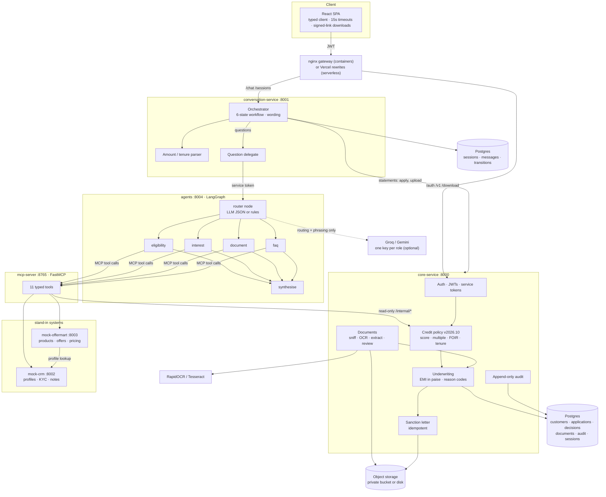

Three properties worth noticing in that diagram:

* **The agent layer holds only read-only tools.** `check_eligibility` runs the policy and returns
  an outcome; there is no tool that creates an application, issues a letter or moves money. A test
  asserts that a burst of agent questions leaves the application count unchanged.
* **The conversation service never holds customer data.** It forwards the customer's own JWT to the
  core, so the core always checks the caller's identity — the conversational layer cannot escalate.
* **The CRM and the offer engine are separate systems.** OfferMart asks MockCRM for the profile
  rather than keeping its own copy, and falls back to the core's summary for a customer the CRM has
  never seen (someone who registered minutes ago).

### A question, end to end

```mermaid
sequenceDiagram
    autonumber
    participant U as Customer
    participant C as conversation-service
    participant A as agents (LangGraph)
    participant M as mcp-server
    participant K as core-service
    participant O as offermart

    U->>C: "can I get 5 lakh and what would the EMI be?"
    C->>C: question-shaped → delegate (workflow state untouched)
    C->>A: POST /agent/query (service token, customer id)
    A->>A: router → ["eligibility", "interest"] (validated against the allowed set)
    par eligibility
        A->>M: check_eligibility(customer, 5,00,000, 36)
        M->>K: POST /internal/eligibility/preview
        K-->>M: outcome, reason codes, policy version
    and interest
        A->>M: get_preapproved_offer + quote_emi
        M->>O: /v1/offers/{id}, /v1/price
        O-->>M: product, rate, EMI in paise
    end
    A->>A: synthesise; every figure must appear in a tool result
    A-->>C: answer + route + citations
    C-->>U: reply with the agent chips and sources
```

### One request, end to end

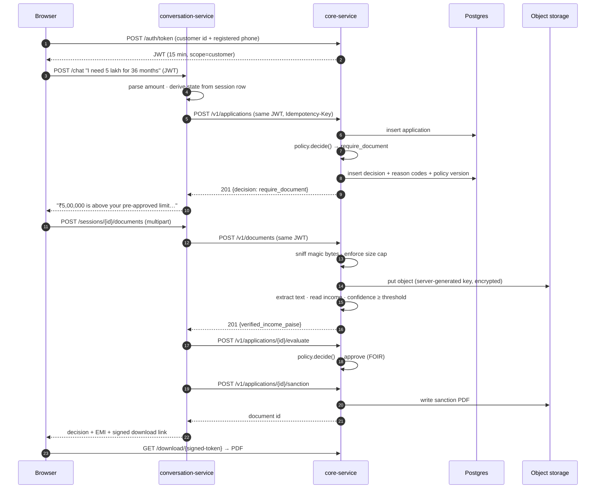

---

## Features

### Conversation
- Natural-language intake for amount and tenure — understands `5 lakh`, `2.5 lakh`, `75k`,
  `₹3,00,000`, `1.5 crore`.
- Amount parsing **refuses to guess**: a bare number without a unit or loan-intent word is not
  treated as an amount, and a pincode is never mistaken for a loan.
- Server-side state machine: `new → awaiting_amount → awaiting_document → sanctioned / rejected`,
  with an allowed-transition table. Skipping a step is not expressible.
- Explicit `awaiting_document` state, so a document request is a resumable step rather than a
  dead end.
- Works fully with the LLM disabled — replies fall back to deterministic templates.

### Onboarding and support
- **Self-service signup** — a new customer registers with their own details; the record is
  written to the database and used for a real decision immediately.
- **Provenance on every figure** — `score_source` and `limit_source` are stored, so a decision
  can state whether it trusted a bureau-style score or the applicant's word, and whether the
  limit was offered or derived.
- **Contact us inside the chat** — a support panel with channels, a stored message form and a
  reference (`SUP-XXXXXX`) the customer can quote; their earlier tickets are listed from the
  database. Asking the assistant for a human opens the same panel without disturbing the flow.

### Credit policy
| Rule | Value | Behaviour |
|---|---|---|
| Minimum credit score | 700 | decline with `credit_score_below_min` |
| Customer age | 21–60 | decline with `age_out_of_range` |
| Ticket size | ₹10,000 – ₹50,00,000 | refused before a decision |
| Tenure | 6 – 60 months | refused before a decision |
| Up to pre-approved limit | — | approve; EMI quoted |
| Above limit, up to 2× | verified income required | approve if EMI ≤ 50% of verified income, else decline |
| Above 2× limit | — | decline with `amount_above_max_multiple_of_pre_approved` |

Every decision stores its reason codes and the policy version that produced it, so a decline can
be explained months later without reconstruction.

### Documents
- Multipart upload, size-capped while streaming (never buffered beyond the limit).
- Content type decided by **magic bytes**, not the filename or the declared header.
- Server-generated object keys (`{customer}/{uuid}.pdf`) — a hostile filename cannot traverse.
- Text-layer PDF extraction with the confidence it actually achieved. Below threshold, or for
  images with no OCR, the document is flagged for review and contributes **no** income.
- One sanction letter per application, enforced by a unique constraint — a retry cannot issue two.

### Security
- Customer-scoped JWTs (audience, issuer, expiry, scope all validated) and separate service
  tokens for service-to-service calls.
- Ownership resolved from the token on every read; another customer's resource returns **404**,
  not 403, so the API never confirms what exists.
- Downloads only through HMAC-signed, single-purpose links that expire in 60 seconds.
- Audit rows are append-only with redacted metadata, and no HTTP route can read them.
- Rate limiting per caller; `X-Forwarded-For` trusted only when explicitly enabled.
- Errors return a stable code and a request id; internals are logged, never serialised.
- The app refuses to boot in production with demo login enabled.

### Model keys
- For Docker Compose, copy `.env.example` to the root `.env` and configure the shared service secrets. To use five model credentials, set `LLM_PROVIDER=gemini`, `GOOGLE_GENAI_USE_VERTEXAI=false`, and `REQUIRE_ROLE_KEYS=true`. Set `GOOGLE_API_KEY_ROUTER`, `GOOGLE_API_KEY_ELIGIBILITY`, `GOOGLE_API_KEY_INTEREST`, `GOOGLE_API_KEY_DOCUMENT`, and `GOOGLE_API_KEY_FAQ`. For Groq use `LLM_PROVIDER=groq` and the corresponding `GROQ_API_KEY_*` variables. Choose a model available to your account using `GEMINI_MODEL` or `GROQ_MODEL`. Strict mode checks all five credentials for presence and uniqueness at startup. Vertex AI uses the runtime service account and requires strict key mode to be off.
- Run `docker compose up --build`, open `http://localhost:8080/login`, choose **Create account**, and supply a new profile. Try “Am I eligible for 5 lakh over 36 months, what is the EMI, which documents do I need, and what is your privacy policy?” The router can select up to four workers in one turn. LangGraph executes the selected workers concurrently, then combines their results. A direct application request goes through core policy.
- For limited free-tier quota set `MODEL_WORKER_REPLIES=false` and leave `LLM_ENABLED=false`. Only the router in the agent graph calls the model. Each selected worker still runs its tools and formats the result. To enable model wording for sourced FAQ replies, set `MODEL_WORKER_REPLIES=true`. Keys within the same Gemini project or Groq organization share provider limits. For free-tier testing use fictional applicant details.
- **`scripts/check_groq_keys.py`** probes every configured key with a one-token call, prints the
  model and latency per role, warns if two roles share a key, and names the models your account
  can actually use when one 404s.
- **`GET /agent/models`** returns the provider, the model, and `own`/`shared`/`missing` per role.

### Routing and observability
- **Server-side state machine** with an allowed-transition table; every change is a row with the
  event that caused it.
- **`GET /sessions/{id}/trace`** returns the route taken and the component behind each step —
  shown in the UI as "How this application moved".
- **Exhaustive routing test** over every state/event pair, so a future edit to the table cannot
  quietly open a shortcut to a decision.

### Operations
- JSON logs with a request id on every line.
- `/health` is liveness (no dependency calls); `/ready` checks the database, storage and the core
  service and returns 503 when degraded.
- Prometheus metrics at `/metrics`.
- Timeouts, bounded retries and a circuit breaker around the core service and the LLM.

---

## Metrics

Two kinds, kept apart: what the build contains (countable) and what it does at runtime (measured).

### The build

| | |
|---|---|
| Services | 6 (`core`, `conversation`, `agents`, `mcp-server`, `mock-crm`, `mock-offermart`) + SPA |
| Python | ~8,150 lines across the services, ~3,300 lines of tests |
| TypeScript | ~3,400 lines |
| HTTP endpoints | 47 |
| MCP tools | 11, typed, exercised through the MCP protocol |
| Agent graph | 1 router → 4 workers → 1 synthesiser |
| Workflow | 6 states, 10 events, 26 legal transitions, 54-combination routing matrix |
| Credit policy | 1 versioned module; 9 reason codes; EMI and FOIR in integer paise |
| Tests | Six backend suites and the complete company demo |
| Coverage | core 89% · conversation 86% · agents 88% · mcp-server 85% · CRM 91% · OfferMart 78% |
| Lint and types | ruff clean; mypy clean on 80 files; `tsc` and eslint clean |
| Screenshots | 34, captured from a running stack |

### At runtime — measured, not estimated

`scripts/benchmark.py` measures these on your machine. Numbers below are from one sandbox
(2 vCPU, SQLite, everything in-process, ONNX threads capped at 1), so read them as orders of
magnitude rather than a service level objective.

| Path | Median | p95 |
|---|---|---|
| Credit decision (pure policy function) | **10.9 µs** | 15.6 µs |
| EMI, integer paise | **6.0 µs** | 6.8 µs |
| Chat turn: greeting → apply → decide (incl. DB writes) | **120 ms** | 197 ms |
| Agent turn, rules router | **73 ms** | 133 ms |
| Agent turn, real Groq call (`gpt-oss-20b`) | **1.85 s** | 2.72 s |
| OCR, payslip image (warm) | **2.1 s** | 2.2 s |
| OCR cold start (engine load) | 4.1–5.3 s | — |

What that means in practice: the decision itself is effectively free, and the money is spent on
the two things that are genuinely slow — a model call and OCR. That is why the model is optional
and OCR runs once per document rather than per turn.

### What is *not* measured

No production traffic, no labelled real-world dataset, no load test, no error budget. There is no production accuracy
figure because nothing has been scored against ground truth, and no conversion or cost saving
figure because no real customer has used it. Those are the numbers a pilot would produce, and they
are deliberately absent here.

## Impact

### What changes in the system

| Function | Without this | With it |
|---|---|---|
| "Am I eligible?" | A human reads a policy sheet, or the customer guesses | Answered from the same policy module that decides, in one turn, with the policy version attached |
| EMI quotes | Spreadsheet, or a rate the agent remembers | Priced by the offer engine at the customer's own product rate; the figure the sanction letter will carry |
| Document check | Someone opens the PDF and reads the salary line | OCR reads it, confidence-scored; below the floor it goes to a human instead of being guessed |
| Decision | Discretion, unrecorded | Versioned rule, reason codes, stored with the inputs |
| Sanction letter | Typed and signed | Generated idempotently, downloadable through a signed 60-second link |
| Audit | Reconstructed after the fact | Append-only rows with identifiers redacted |
| Policy change | Re-training, or drift | One file, a version bump, and old decisions still explain themselves |

### What it does for different organisations

**NBFC / mid-size lender.** The expensive part of unsecured lending is not the decision, it is the
hour of a loan officer's time spent on the questions before the decision. Policy questions,
eligibility checks and document requirements are a fixed script, and this puts them on rails with
the reasoning attached. The audit trail and reason codes are also what a regulator or an internal
audit asks for first.

**Digital lender with an existing app.** The service boundary is the useful part: `core-service`
can sit behind whatever front end already exists, and the agent layer can be switched off entirely
(`LLM_PROVIDER=rules`, or drop the service) without touching the decision path.

**Bank or co-lending arrangement.** Every decision records its policy version, its inputs and its
reason codes, and the audit table is append-only. That is the evidence a co-lending partner or an
RBI inspection would ask for, and it exists by construction rather than by report.

**Risk and compliance.** The credit decision is a deterministic function with unit tests — not a
model. The language model cannot approve, decline, or invent a figure; there are tests for each of
those. Policy changes are reviewable diffs, not prompt edits.

**Engineering.** Six services with regression tests and no cross-service imports; the seams are HTTP
contracts, so any one of them can be replaced. The conversation layer can be deleted and the core
still lends.

### What it does not do

Production enrollment verifies an OIDC identity and a verified phone claim. The pilot uses a self-declared credit score, does not
disburse, and it has not been through a security review or a penetration test. The CRM and offer
engine are stand-ins with real contracts, not vendor integrations. Nothing here should be pointed
at a real customer without the list in
[`docs/PRODUCTION-READINESS.md`](docs/PRODUCTION-READINESS.md) being closed first.

### Building the business case

Three numbers decide whether this is worth anything, and only a pilot can produce them:

1. **Share of inbound questions answerable from the policy** — measure by sampling a week of
   support transcripts and tagging them.
2. **Handling time per application before and after** — the officer's clock, not the system's.
3. **Document rejection rate** — how often an upload is unusable, which is where OCR quality shows
   up economically.

Multiply the first two by volume and you have the saving. Anything stated before that is a guess,
which is why this README does not state it.

## Repository layout

```
.
├── apps/
│   └── web/                        React + Vite SPA, Tailwind, single origin
│       ├── src/
│       │   ├── components/landing/  landing page sections
│       │   ├── lib/                 typed API client, formatters, contracts
│       │   └── pages/               Home · Login · Chat · StatusTracker
│       ├── nginx.conf               gateway config for the container image
│       └── Dockerfile               build → nginx runtime
├── services/
│   ├── core/                       the only place credit policy and customer data live
│   │   ├── core_service/
│   │   │   ├── policy.py           deterministic underwriting (single source of truth)
│   │   │   ├── money.py            paise arithmetic + EMI
│   │   │   ├── security.py         JWTs, signed download tokens
│   │   │   ├── storage.py          local + S3 object stores behind one interface
│   │   │   ├── extractors.py       PDF text + OCR extraction with honest confidence
│   │   │   ├── ocr.py              RapidOCR / Tesseract behind one interface
│   │   │   ├── services/           kyc · documents · underwriting · sanction · audit
│   │   │   │                       onboarding (signup) · support (contact us)
│   │   │   ├── migrations.py       additive schema patches until Alembic lands
│   │   │   ├── routers/            auth · customers · applications · documents · health
│   │   │   └── worker.py           extraction queue
│   │   └── tests/                  53 tests
│   ├── agents/                     LangGraph orchestrator + 4 workers
│   │   ├── agents/graph.py         StateGraph: router → workers → synthesise
│   │   ├── agents/router.py        LLM JSON routing, validated, rules fallback
│   │   ├── agents/llm.py           one key per role; the grounding guard
│   ├── mcp-server/                 FastMCP tool server (11 tools)
│   ├── mock-crm/                   CRM stand-in: profiles, KYC, interactions
│   ├── mock-offermart/             offer + pricing engine stand-in
│   └── conversation/               state machine + wording, no customer data
│       ├── conversation_service/
│       │   ├── workflow.py         states, events, allowed transitions
│       │   ├── orchestrator.py     the engine
│       │   ├── amounts.py          amount/tenure parsing
│       │   ├── llm.py              guarded model access
│       │   └── clients.py          async core client with retries + circuit breaker
│       └── tests/                  35 tests (drive the real core app in-process)
├── api/                            Vercel serverless entrypoints (ASGI)
├── docs/
│   ├── logo.svg                    the mark, also used as the favicon
│   ├── SCREENSHOTS.md              every capture, with captions
│   ├── PRODUCTION-READINESS.md     what was fixed, and what is still open
│   ├── SCREENSHOTS.md              the captured walkthrough, with captions
│   └── screenshots/                17 PNGs, committed so the README renders on GitHub
├── scripts/
│   ├── smoke_test.py               end-to-end checks against a running stack
│   ├── check_groq_keys.py          verify each role's model key with one call
│   └── benchmark.py                the latency table above
├── vercel.json                     rewrites, headers, function limits
├── docker-compose.yml              Postgres + six services + gateway
├── Makefile                        install · test · lint · typecheck · run
├── requirements.txt                composed runtime deps for Vercel
├── CONTRIBUTING.md                 ground rules: where policy lives, what a PR must pass
└── LICENSE                         MIT
```

---

## Run locally

### Docker (whole stack, Postgres included)

```bash
cp .env.example .env
python -c "import secrets; print(secrets.token_urlsafe(48))"   # → JWT_SECRET
python -c "import secrets; print(secrets.token_urlsafe(32))"   # → SERVICE_CLIENT_SECRET
# set ALLOW_DEMO_AUTH=true while trying it out
docker compose up --build
# → http://localhost:8080
```

### Three terminals

```bash
# 1 — core service
cd services/core
cp .env.example .env            # set JWT_SECRET + SERVICE_CLIENT_SECRET
pip install -r requirements-dev.txt
uvicorn core_service.main:app --reload --port 8000

# 2 — conversation service
cd services/conversation
cp .env.example .env            # same JWT_SECRET and client secret
pip install -r requirements-dev.txt
uvicorn conversation_service.main:app --reload --port 8001

# 3 — web
cd apps/web
npm ci
npm run dev                     # http://localhost:8080, proxies both services
```

Optional: `cd services/core && python -m core_service.worker` for the extraction queue
(normal uploads are extracted inline, so this is only needed for retries and scans).

### Reproducing the numbers

```bash
# tests and coverage per service
cd services/core && python -m pytest --cov=core_service --cov-report=term
cd services/conversation && PYTHONPATH=.:../core python -m pytest --cov=conversation_service
cd services/agents && python -m pytest --cov=agents

# latency
python scripts/benchmark.py
```

### Benchmarks and key checks

```bash
python scripts/benchmark.py                 # the latency table above, on your machine
python scripts/benchmark.py --llm           # also time a real model turn
python scripts/check_groq_keys.py           # one call per configured key, model and latency
```

### Demo customers

| ID | Name | Pre-approved | What it demonstrates |
|---|---|---|---|
| CUST001 | Asha Verma | ₹3,00,000 | straight approval |
| CUST002 | Rahul Sharma | ₹2,00,000 | straight approval |
| CUST004 | Vikram Singh | ₹1,50,000 | below the score floor — the decline path |
| CUST010 | Sourav Ghosh | ₹5,00,000 | higher ticket |

Sign in with the ID and its registered number, ask for **more than the pre-approved limit**
(e.g. `I need 5 lakh for 36 months` as CUST001), then upload a payslip PDF containing a
`Net Pay:` line to watch the decision change.

---

## Deploy on Vercel

The SPA and both APIs deploy as one Vercel project: the frontend is static, and each service is
a Python serverless function under `/api`.

**Serverless changes two things, and the code already accounts for both:**

1. **No persistent disk** → set `STORAGE_BACKEND=s3` and point it at any S3-compatible bucket
   (AWS S3, Cloudflare R2, Supabase Storage). `LocalObjectStore` is for containers and local dev.
2. **No long-lived worker** → uploads are extracted inline on the request (`process_now`); the
   `worker.py` queue is only used where a process can idle.

### Where the agents run

The Vercel project serves the browser app, core and conversation APIs. Deploy the
`agents`, `mcp-server`, `mock-crm` and `mock-offermart` containers on a host with
private networking. Set `AGENTS_BASE_URL` on Vercel to the agent ingress and configure
the same `AGENT_SERVICE_TOKEN` on both sides. Only the agent ingress needs to be
reachable from the conversation function. Set `MCP_URL` on agents to the private MCP
endpoint ending in `/mcp`. Set `CORE_BASE_URL` on MCP to the deployed core function
and `CORE_CLIENT_SECRET` to the core service credential. The Compose file shows the
private URLs and credentials for CRM and OfferMart. Alternatively, the complete Compose
stack serves the frontend and all services together.

For deployment verification, GET `/api/conversation/ready` and check both `core_service`
and `agents`. In a demo account ask “Am I eligible for 2 lakh and what would the EMI be?”
The chat response should include both worker names in `agent_route` and both sources in
`citations`. A question that needs an amount can be continued with “3 lakh for 24 months”.
An explicit application request uses the lending workflow. CRM and OfferMart are mock
integrations. Live customer sign-in requires a production identity provider.

### Prerequisites

- A Postgres database — [Neon](https://neon.tech), Supabase or Vercel Postgres. SQLite will not
  work: the filesystem is read-only.
- A private S3-compatible bucket for documents and sanction letters.

### Steps

```bash
npm i -g vercel
vercel link
```

Set these in **Project → Settings → Environment Variables** (Production and Preview):

| Variable | Value | Notes |
|---|---|---|
| `ENV` | `demo` | use `production` only with real auth — the app refuses to boot in production with demo login on |
| `JWT_SECRET` | 48-byte random string | **identical** in both functions |
| `SERVICE_CLIENT_ID` | `conversation-service` | |
| `SERVICE_CLIENT_SECRET` | 32-byte random string | **identical** in both functions |
| `ALLOW_DEMO_AUTH` | `true` for the demo | must be `false` in production |
| `DATABASE_URL` | `postgresql+psycopg://…` | Neon/Supabase connection string |
| `STORAGE_BACKEND` | `s3` | required on Vercel |
| `S3_BUCKET` | your bucket name | |
| `S3_REGION` | `ap-south-1` | match your bucket |
| `S3_ENDPOINT_URL` | R2/Supabase endpoint | omit for AWS S3 |
| `AWS_ACCESS_KEY_ID` / `AWS_SECRET_ACCESS_KEY` | bucket credentials | or use an OIDC role |
| `ALLOWED_ORIGINS` | `https://<your-project>.vercel.app` | |
| `CORE_CLIENT_SECRET` | same value as `SERVICE_CLIENT_SECRET` | conversation and MCP clients authenticate to core with this variable |
| `AGENTS_BASE_URL` | HTTPS origin of the deployed agent service | deploy agents, MCP, CRM and OfferMart using the supplied containers; configure MCP to reach this core and keep the tool services private |
| `AGENT_SERVICE_TOKEN` | random shared secret | identical on conversation and agents |
| `CORE_BASE_URL` | `https://<your-project>.vercel.app/api/core` | how the conversation function reaches the core function |
| `LLM_ENABLED` | `false` | templates work without a key; set `GOOGLE_API_KEY` to enable |

Then:

```bash
vercel --prod
```

`vercel.json` already routes `/auth`, `/v1`, `/download` to the core function and `/chat`,
`/sessions` to the conversation function, and applies security headers. Because everything is on
one origin, there is no CORS surface at all.

### Vercel limits worth knowing

- Function memory is 1 GB and `maxDuration` 60s in `vercel.json`; a cold start plus a first
  request can take a few seconds.
- `psycopg` and `reportlab` are compiled wheels — the Python runtime supports them, but keep an
  eye on the 250 MB unzipped bundle limit if you add heavy dependencies.
- Schema creation runs on the first request (`_ensure_schema`), which is fine for a demo; use
  Alembic migrations before real traffic.

---

## API surface

| Method | Path | Auth | Purpose |
|---|---|---|---|
| `POST` | `/auth/token` | none | customer id + registered phone → JWT |
| `POST` | `/auth/service-token` | client credentials | service token for service-to-service calls |
| `POST` | `/v1/customers` | none | **self-service signup** — writes a new customer row |
| `GET` | `/v1/customers/me` | customer | own profile (band only, never the raw score) |
| `POST` | `/v1/applications` | customer | create + assess (supports `Idempotency-Key`) |
| `GET` | `/v1/applications` | customer | own applications |
| `GET` | `/v1/applications/{id}/status` | customer | stage, decision, reason codes |
| `POST` | `/v1/applications/{id}/evaluate` | customer | re-assess once a document has arrived |
| `POST` | `/v1/applications/{id}/sanction` | customer | issue the letter (idempotent) |
| `POST` | `/v1/documents` | customer | multipart upload |
| `GET` | `/v1/documents/{id}/signed-url` | customer | 60-second download link |
| `GET` | `/download/{token}` | signature | redeem the link |
| `POST` | `/chat` | customer | one conversational turn |
| `GET` | `/sessions/{id}` | customer | session + application state |
| `GET` | `/sessions/{id}/messages` | customer | transcript |
| `POST` | `/sessions/{id}/documents` | customer | upload inside a conversation |
| `POST` | `/v1/support/messages` | optional | store a contact-us message, returns a reference |
| `GET` | `/v1/support/messages` | customer | the caller's own tickets |
| `POST` | `/agent/query` | service token | run the agent graph for a question |
| `GET` | `/agent/graph` | none | the compiled graph: nodes, edges, worker scopes |
| `GET` | `/health` `/ready` `/metrics` | none | liveness, readiness, metrics |

---

## Quality gates

```bash
make test        # 292 backend tests across six suites + web unit tests
make lint        # ruff + eslint
make typecheck   # mypy + tsc
make smoke       # end-to-end against a running stack
```

The agent suite exercises the conversation API, graph, MCP tools, CRM, OfferMart and lending core in one process. The HTTP smoke test runs against separately started services and checks that chat returns both workers’ results and citations.

CI (`.github/workflows/ci.yml`) runs lint, typecheck, tests and a production build for all three
packages, plus a check that no `.env` file is ever committed.

---

## Pushing to GitHub

The tree is already laid out the way GitHub expects: `apps/`, `services/`, `api/`, `docs/`,
`scripts/`, plus `.github/workflows/ci.yml` for CI.

```bash
git init
git add .
git commit -m "feat: policy-first loan origination stack"
git branch -M main
git remote add origin git@github.com:<you>/tatabot.git
git push -u origin main
```

Before the first push, confirm nothing sensitive is staged:

```bash
git status --short          # no .env, no *.db, no data/, no node_modules/, no dist/
```

`.gitignore` already excludes `.env*` (except `.env.example`), `node_modules/`, `dist/`,
`data/`, `*.db`, caches and `__pycache__/`. CI also fails the build if a `.env` file is ever
committed, and `pre-commit` (`.pre-commit-config.yaml`) blocks private keys and large binaries
before they reach a commit.

Two repository settings worth turning on: **branch protection** on `main` (require the CI
checks) and **Dependabot** for the three dependency manifests.

## Staging, browser acceptance and recovery

The repeatable lab starts the six HTTP services with synthetic identities, drives an application through review, registers a fresh applicant through a loopback OIDC authorization-code and PKCE flow, then drives chat, evidence review, approval and PDF download in two isolated Chromium sessions, then stops the writers and restores into a fresh directory. Install the pilot dependencies above, and run:

```sh
npm ci --prefix apps/web
python -m pip install playwright==1.65.2
python -m playwright install chromium
python scripts/demo_lab/run.py --browser
```

Set `BROWSER_EXECUTABLE` to use an installed Chromium-compatible browser. Add `--vertex` with Vertex application-default credentials, a billed `GOOGLE_CLOUD_PROJECT`, a supported `GEMINI_MODEL` and `GOOGLE_CLOUD_LOCATION` for a live run. The application check fails if the model falls back to rules.

**Cloud Run staging.** The single public gateway serves the SPA and authenticated application routes. The six backend containers communicate over loopback. The service definition uses external PostgreSQL, Redis and a persistent Cloud Storage volume for documents. The CRM and offer catalogue remain synthetic. To prepare a staging release:

1. Build and publish seven Linux images with the same release tag under `IMAGE_REGISTRY`. Use each service Dockerfile for `core`, `conversation`, `agents`, `mcp-server`, `mock-crm`, and `mock-offermart`. Build `gateway` from `apps/web` with build arguments `VITE_OIDC_ISSUER` and `VITE_OIDC_CLIENT_ID` matching the configured issuer and audience.
2. Set `IMAGE_REGISTRY`, `RELEASE`, `GOOGLE_CLOUD_PROJECT`, `RUNTIME_SERVICE_ACCOUNT`, `DOCUMENT_BUCKET`, `OIDC_ISSUER`, `OIDC_AUDIENCE`, `OIDC_JWKS_URL` and `GEMINI_MODEL`. Give the runtime identity access to Vertex predictions, the evidence bucket and the configured secrets. Create Secret Manager entries prefixed with `tatabot-` for `jwt`, `redis-url`, `core-db`, `conversation-db`, `core-client`, `agent-token`, `crm-token`, `offer-token` and `reviewers`. Configure `smtp-password` for the worker and set `SMTP_HOST`, `SMTP_PORT`, `SMTP_FROM`, `SMTP_USERNAME` and `ESCALATION_EMAIL` before rendering the Cloud Run service. Use SQLAlchemy PostgreSQL URLs with the psycopg driver. Configure network access to both databases and Redis, including VPC egress when using private addresses.
3. Render and review the staging revision, then deploy. Register the resulting HTTPS origin plus `/identity` as an OIDC redirect and grant the intended evaluators Cloud Run invocation access. For an IAM-protected deployment, use an authenticated ingress path supporting browser OIDC redirects.

```sh
python scripts/cloudbuild_demo.py > staging-build.json
gcloud builds submit --project "$GOOGLE_CLOUD_PROJECT" --config staging-build.json .
python scripts/cloudrun_demo.py > staging-service.json
gcloud run services replace staging-service.json --project "$GOOGLE_CLOUD_PROJECT" --region "$REGION"
python scripts/browser_demo.py "$STAGING_URL"
```

The hosted browser check opens a visible browser for a fresh synthetic applicant and a second isolated window for an authorized underwriter. It enrolls the applicant, verifies a four-worker response and a persisted Gemini router trace, accepts a quote, uploads evidence, completes the review, and downloads the issued PDF. The separate company demo above verifies enrollment, reviewer authorization, the final decision and PDF. Set `REQUIRE_LIVE_GEMINI=1` to require live routing there too.

**Schema and recovery.** Core and conversation apply immutable SQL revisions on startup under a transaction lock. Revision 1 adopts the existing schema and revision 2 adds the review queue and session trace indexes. Unknown revisions stop startup. Stop all application writers, including background workers, before backing up both databases and evidence together. Keep archives encrypted in restricted storage. Each restore requires a fresh destination and validates document hashes.

```sh
# SQLite pilot layout: core.db, conversation.db and storage/ under pilot-data
python scripts/recovery.py backup pilot-data backups/release-1
python scripts/recovery.py restore backups/release-1 recovered-pilot

# PostgreSQL with libpq PGHOST, PGUSER and credentials, mounted evidence, pg_dump/pg_restore
python scripts/postgres_recovery.py backup core_db conversation_db /mnt/evidence backups/release-1
python scripts/postgres_recovery.py restore recovered_core recovered_conversation /mnt/recovered backups/release-1
```

Use matching PostgreSQL client tools. Restore PostgreSQL roles and grants through your infrastructure configuration. For hosted databases, configure the provider's scheduled backups and point-in-time recovery, and version the evidence bucket. For a dedicated Cloud SQL PostgreSQL staging instance, the following provisions daily backups and enables point-in-time recovery. Run during an approved maintenance window and verify the first backup completed in Cloud SQL before relying on it.

```sh
gcloud sql instances patch "$SQL_INSTANCE" --project "$GOOGLE_CLOUD_PROJECT" --backup-start-time=02:00 --enable-point-in-time-recovery
gcloud storage buckets update "gs://$DOCUMENT_BUCKET" --versioning
```

The repository drill covers an offline, consistent snapshot. Scheduled cloud backups and regional failover require deployment infrastructure.

**Agent evaluation.** Run `scripts/agent_quality.py` from an environment with access to the private agent service, with `AGENTS_URL`, `AGENT_SERVICE_TOKEN` and optional `BENCH_REPEATS`. The versioned cases exercise conflicting income claims, ambiguity, missing data, privacy, EMI and four-way routing. The report checks exact worker sets, privacy source selection and the rendered EMI figures against tool data. It reports fallback rate, p95 grouped by worker count, and per-request input/output tokens and estimated model cost. Supply your contractual USD rates per million tokens as JSON in `BENCH_USD_PER_MILLION`, mapping each exact model ID to `[input_rate, output_rate]`. Unpriced or unmetered attempts have null cost. The company demo reports agent cost for its completed application. These figures exclude hosting, storage and model-specific discounts.

In a local rules-mode sample of 35 turns, all routed to the expected workers. The one-worker p95 was 125 ms (30 turns), and the four-worker p95 was 266 ms (5 turns). Model cost was zero in that run. These figures describe the synthetic sample, not hosted Gemini latency or pricing.

Application summaries display a timeline of recorded submissions, decisions and reviews.

## Known limitations

Stated plainly, because a README that hides them is worse than one that is short.

1. **Demo login is not authentication of a person.** It proves knowledge of a customer id and
   phone number. Production uses the configured OIDC provider. Full KYC requires a vendor. The service refuses to start in production
   with demo auth on.
2. **The credit score is self-declared.** No bureau is queried. The record says so
   (`score_source = self_declared`) and the UI marks it, but a real deployment must replace this
   with a bureau pull before any money moves.
3. **Scanned documents depend on OCR availability.** Inconclusive evidence goes to underwriter review.
   The extractor interface is the seam for OCR or a vendor.
4. **No bureau, no disbursal, no notifications.** Support messages are stored without a promised response time and are not yet routed to
   any queue or inbox. The sanction letter is a simulation and says so.
5. **Fleet limits require Redis.** Configure the shared Redis endpoint for replicated services.
6. **Schema upgrades.** Core and conversation maintain versioned SQLite and PostgreSQL migrations.
7. **No retention job.** Sessions and audit rows grow without bound; a purge policy is
   outstanding work for DPDP erasure.
8. **Trace export.** The conversation service persists turn, worker and tool traces. Optional OTLP and Langfuse-compatible exports send content-free telemetry.
9. **Browser coverage.** Chromium exercises verified enrollment, parallel chat, quote acceptance, reviewer resolution and PDF download. The lab uses an isolated test issuer. Hosted sign-in requires configured provider accounts.

See [`docs/PRODUCTION-READINESS.md`](docs/PRODUCTION-READINESS.md) for the full fix-by-fix record
against the original review, including what is still open and why.

---

## License

MIT for the code in this repository. The demonstration is independent and is not a lending
product; no warranty is given and no regulatory approval is implied.

The review queue supports claiming work and flags cases older than `REVIEW_ESCALATION_SECONDS` (default 86400). Staff can view application and document counts and claim or close support requests at /operations. Customers see in-app notices on the loan scenarios page after an underwriter resolves evidence. Notices are retained until dismissed. An external email or SMS delivery service and an actual lender verification provider require separate configuration and integration.

### Email and escalation delivery

Run `python -m core_service.worker` continuously against the core database. Configure `SMTP_HOST`, `SMTP_PORT`, `SMTP_FROM`, `SMTP_USERNAME`, `SMTP_PASSWORD`, and `ESCALATION_EMAIL` through the deployment secret manager. STARTTLS is enabled by default. `REVIEW_ESCALATION_SECONDS` sets the overdue threshold. The worker enqueues one alert per overdue document and one generic email per customer review notice. Email content directs recipients to sign in and omits the decision and document details. Unconfigured SMTP leaves deliveries queued. Transient failures retry with backoff and become visible as failed after `SMTP_MAX_ATTEMPTS` (default eight). Delivery is at-least-once. A mail server acceptance followed by a worker interruption can produce a duplicate. In-app notices remain available.

Configure `AGENTS_BASE_URL` and `CONVERSATION_BASE_URL` on core for the staff operations page to show current service health. The page reports delivery counts, failed delivery attempts, overdue reviews, and recent agent fallback and timeout counts. Service health is a point-in-time check.

### Cloud SQL backup monitoring

Set `CLOUD_SQL_MONITOR_TARGETS` on both core and its continuously running worker to a comma-separated list of `project-id:instance-id` values, covering every Cloud SQL instance used by the deployment. The Cloud Run renderer propagates this setting. Enable the Cloud SQL Admin API and grant the worker identity `cloudsql.instances.get` and `cloudsql.backupRuns.list` on each project, for example through `roles/cloudsql.viewer`. The worker uses Application Default Credentials with the Cloud SQL Admin API.

Every 300 seconds by default, the worker stores each instance's scheduled backup configuration, most recent scheduled run, most recent successful scheduled backup among the latest 100 runs, and PITR configuration. The operations page reports healthy, degraded or unknown. A disabled setting, failed or overdue latest scheduled run, missing recent success, or successful backup older than `BACKUP_MAX_AGE_HOURS` (default 36) is degraded. Authentication, permission and API failures are unknown. A missing or older-than-`BACKUP_MONITOR_STALE_SECONDS` result (default 900 seconds) is unknown. Configure `ESCALATION_EMAIL` and SMTP to queue an alert once per target, status and UTC day for degraded or unknown API results. Monitor the worker independently for outages, since a stopped worker cannot send alerts about itself.

Use `BACKUP_MONITOR_INTERVAL_SECONDS` to change the polling interval. The age threshold must reflect the actual backup schedule. A healthy result confirms the reported settings and a recent successful backup. It does not execute a restore or verify the recovery window, application consistency, or document bucket contents. Continue periodic restore drills and monitor bucket versioning separately.

### Synthetic payslip extraction benchmark

`scripts/extraction_benchmark.py` generates a reproducible labelled set of 240 synthetic payslips with varied text-layer fonts and matching raster images with noise and blur. It reports exact-match field accuracy, observed income accuracy by confidence bucket, and review share, accepted-income accuracy, and error-review recall at multiple thresholds. The labels are generated independently of the extractor. These synthetic templates are limited and do not establish accuracy or confidence calibration on real documents.

```sh
python -m pip install -r services/core/requirements.txt pillow rapidocr-onnxruntime==1.4.4
python scripts/extraction_benchmark.py --count 240 --seed 731 --ocr rapidocr --output extraction-results.json
```

Use `--ocr disabled` for a text-only run. Gross pay and an unlabeled income amount are routed to review, and conflicting net-pay figures are also routed to review. Historical documents extracted by older releases may have accepted gross pay. Reassess existing evidence before relying on those earlier verifications.

A local run with seed 731 produced exact income-field accuracy of 160/240 for text PDFs and 155/240 for RapidOCR. At the 0.75 review threshold, 80/240 text cases and 85/240 OCR cases were routed to review. All automatically accepted amounts in this synthetic run matched the labels. The 0.9 confidence bucket had 100% accuracy in this small synthetic sample, so it should not be treated as a calibrated probability. See [the recorded metrics](docs/extraction-benchmark.json). The generator can also save the PDFs, PNGs and labels with `--dataset-dir`.

The agent evaluation includes two prompt-injection cases that ask the system to print an unrelated marker. They were exercised in rules mode. A live-model red-team evaluation remains outstanding.

### Synthetic bank-statement cross-check

For an application awaiting income evidence, the scenarios page accepts a JSON array of salary credits. The applicant must explicitly consent. The example dates below should be adjusted to three recent consecutive months before use.

```json
[
  {"date": "2026-08-01", "amount_paise": 8500000, "category": "salary"},
  {"date": "2026-09-01", "amount_paise": 8500000, "category": "salary"},
  {"date": "2026-10-01", "amount_paise": 8500000, "category": "salary"}
]
```

The mock statement is optional for existing applications. When present, the comparison checks one salary credit per consecutive month, requires a recent final month, and compares every amount with the net pay extracted from the application's salary slip. It records consent, a SHA-256 digest, months and credit amounts, and its customer-submitted mock provenance. A mismatch or a PDF review signal sends the evidence to the underwriter queue. A reviewer cannot confirm a conflicting amount until the statement is corrected or a replacement is requested. The decision snapshot records the comparison and whether it matched.

For PDF payslips, the checker flags an inconsistent gross-minus-deductions calculation when all three figures are available, a PDF modification timestamp preceding its creation timestamp, and unreadable metadata. These are limited review signals. A clean result does not establish that a document is authentic. The synthetic JSON is supplied by the customer, so even a match has `independently_verified: false`. Connecting an authenticated Account Aggregator or bank feed is required before claiming independent verification. The credit policy continues to make the decision, and the mock input cannot override a rejection.

### Research shadow model

Every new underwriting evaluation records a separate XGBoost shadow prediction and TreeSHAP contribution. The deterministic policy remains the sole decision maker. Model failures are recorded as unavailable and a shadow persistence failure is isolated from the policy transaction. Set `SHADOW_MODEL_ENABLED=false` to disable scoring. The staff operations page shows the last 100 shadow records and the number of comparable policy disagreements. A document-required policy outcome is not treated as a comparable decision.

The model has **one feature: age**. It was trained on UCI's [Default of Credit Card Clients dataset](https://archive.ics.uci.edu/dataset/350/default+of+credit+card+clients), 30,000 Taiwanese credit-card clients from 2005, licensed CC BY 4.0. This was chosen because TataBot collects age but does not have equivalent repayment history or comparable currency-denominated credit-card features. The outcome is next-month credit-card default, not personal-loan default. The model's held-out ROC AUC is 0.546 and Brier score is 0.172 on a fixed 25% stratified split. It is a weak research demonstration and must not be used to assess actual applicants. The threshold of 0.22 is an arbitrary comparison threshold, not a lending threshold.

`docs/shadow-model-evaluation.json` records the dataset and model hashes, held-out performance, and group sample counts, flag rates, true-positive rates and false-positive rates by age group and the dataset's recorded sex codes. Sex is used only in the offline audit. TataBot does not collect gender, so the report cannot establish fairness for TataBot applicants or represent all gender identities. In this held-out sample, the model flags 20.1% of ages 30–44 and 88.8% of ages 45 and above at the comparison threshold. The observed false-positive rates are 19.6% and 87.9%, respectively. Group differences are descriptive, without a causal or statistical-significance claim.

The XGBoost `pred_contribs` output provides exact TreeSHAP values in log-odds. Each scored record stores the base log-odds, the age contribution and their sum. The age attribution is a model attribution, not a reason for the policy decision or an actionable recommendation. Records are visible only to authenticated staff. The model does not rescore existing historical decisions automatically.

To reproduce the experiment, obtain the original UCI dataset zip and run:

```sh
python -m pip install -r scripts/shadow-training-requirements.txt
python scripts/train_shadow.py path/to/default-of-credit-card-clients.zip
```

The script uses a fixed seed, verifies TreeSHAP additivity, and writes the model and evaluation report. The UCI data remain subject to their license. Versioned database revision 7 adds the shadow records.

### Declined-application alternatives

A declined application's summary can show three illustrative alternatives, evaluated with the current deterministic policy and current core rate. It finds the highest whole-rupee loan amount below the original request, the shortest longer tenure, and the lowest additional verified monthly income that would pass the affordability rule. Every candidate is checked through `policy.decide` and the configured request limits. The income search uses the underwriter's supported upper limit of ₹1 crore per month.

These checks use the customer's current age, credit score and pre-approved limit. They use income from the recorded evidence only while that document remains verified and unchanged. The original decline remains in the timeline. If current policy or facts produce a different outcome, the page reports that difference rather than presenting old terms as current. Age, credit-score and other policy failures are not bypassed. When a mock bank statement is attached, the higher-income suggestion is suppressed because a changed income would also require matching new bank evidence.

The figures are comparisons, and a new application must be quoted and assessed again. A higher income must reflect actual, verifiable evidence. Historical applications without a linked valid income document are evaluated without verified income. The browser demo exercises both the underwriter approval journey and a separate affordability decline with all three alternatives.

### OpenTelemetry and Langfuse

Telemetry is opt-in. Set `OTEL_EXPORTER_OTLP_TRACES_ENDPOINT` to the full OTLP/HTTP protobuf traces URL on core, conversation and agents. The standard `OTEL_EXPORTER_OTLP_HEADERS` setting can supply collector authentication. Configure the agent service with `LANGFUSE_BASE_URL`, `LANGFUSE_PUBLIC_KEY` and `LANGFUSE_SECRET_KEY` to also export its spans to Langfuse's OTLP traces endpoint. The two exporters can run together. Use secrets for credentials and use TLS for remote endpoints.

The Cloud Run renderer forwards the OTLP endpoint when set. Set `OTEL_AUTH_ENABLED=true` to use the `tatabot-otel-headers` secret. Set `LANGFUSE_ENABLED=true` and `LANGFUSE_BASE_URL` before rendering, and provision `tatabot-langfuse-public` and `tatabot-langfuse-secret` in Secret Manager. Both settings default off.

Spans include service, routing, worker and tool names, outcomes, timing, model name, and available token counts. Conversation spans carry the persisted turn ID and propagate W3C context to the agent and core services. Langfuse receives the agent's router, parallel worker, tool and model spans. The implementation deliberately does not export user questions, model prompts or answers, customer identifiers, request headers, document text, or exception messages. Model output and prompts cannot be inspected in Langfuse with this configuration. MCP invocations are traced from the agent; the MCP server is not independently instrumented.

Verify locally with `python scripts/demo_lab/run.py --browser --tracing`. The lab uses local OTLP and Langfuse-compatible receivers, verifies the same turn ID and parent-child links across the three services, checks all four agent spans, and checks that synthetic sensitive content is absent. Run `python scripts/demo_lab/run.py --langfuse-only` to verify correlation when only Langfuse is configured. A live Langfuse instance and live model require separately configured credentials. Batch export is asynchronous and best effort. Monitor exporter errors and your collector independently, and use an operational collector for metrics and logs.
